# flood_defenses — Defenses layer for the fluvial flood hazard pipeline

The package derives **protected areas**: areas protected by flood levees. Each protected area
gets a return period (RP) of protection. The layer clips fluvial hazard maps in
post-processing, so it is built **only from terrain, levee lines, the river network (files
you prepare) and free open data** (GHSL, Copernicus GFM, GloFAS and EFAS). No hazard map, hydraulic
model output, local hazard dataset or FABDEM is used anywhere. Satellite flood extents
(GFM) and simulated discharge (GloFAS, EFAS) enter only as *observations* that bound the
modelled return period; they never draw a protected area.

**Czech quick guide:** [docs/navod_cs.md](docs/navod_cs.md): a short guide to running the
scripts.

**Error priority: recall.** When the evidence is ambiguous, a protected area is kept rather
than dropped. Every design choice below that trades precision for recall says so
explicitly.

| Stage | Content | Status |
|---|---|---|
| A | `gis.py` additions, `prepare_dtm.py`, `build_units.py`, `protected_areas.py` | done, tested, benchmarked |
| A+ | faster kernels; fixes B1–B4; gap filling for water surfaces | done, tested, benchmarked |
| B | `download_ghsl.py`, `rp_index.py` | done, tested on synthetic data; download URLs not verified. The OSM steps (`download_osm.py`, `osm_hydraulics.py`) were removed in Stage G |
| C | `download_gfm.py`, `gfm_evidence.py`, `rp_bounds.py`, `validate.py` | done, tested on synthetic data (26 checks); GFM endpoint, asset names and pixel codes verified on the service on 2026-11-13 (§10.0); the GloFAS part is replaced by Stage F |
| HAND_YZ | `download_worldcover.py`, `HAND_YZ.py`: land cover exposure supplementing GHSL | done, tested on synthetic data (7 checks); WorldCover source verified, Urban Atlas field and codes not verified |
| D | industrial sites, dense urban areas, large systems ([plan](docs/stage_d_plan.md)) | **D1 done** (DSM inspection, GHSL extensions, `download_clms.py`, `context_zones.py`; 8 checks); D2–D5 pending |
| E | implied protection in dense built-up reaches, experimental ([plan](docs/stage_e_plan.md)) | **E1–E5 done** (`snap_rivers.py`, `plots.py`, `implied_segments.py`, `implied_protection.py`, `implied_evaluate.py`; 44 checks); integration with D4 outputs once they exist |
| G | report review ([reports/report_review.md](reports/report_review.md)); OSM removed, rivers always snapped into their channel (§8), "compartment" renamed "protected area"; transport embankments next | **steps 1–2 done** (all tests pass); steps 3–4 pending |
| F | discharge sources GloFAS and EFAS (§11): `download_discharge.py`, `discharge_prepare.py`, `rp_bounds.py` rewritten | **F2–F5 done**, tested on synthetic data (16 checks); **F1 blocked**: the EWDS is not reachable from the session and the test requests need your key, so request values, time convention and EFAS access are not verified |

## How it works in brief

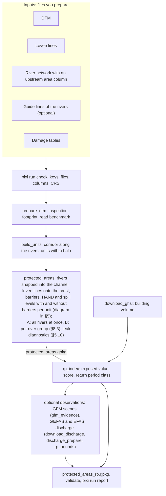

**Principle.** A cell is protected when the levees raise the level at which river water
reaches it (§5.1). Below, the same calculation on a cross-section; the figures are made
by `pixi run make-figures` (`docs/make_figures.py`) from synthetic data.

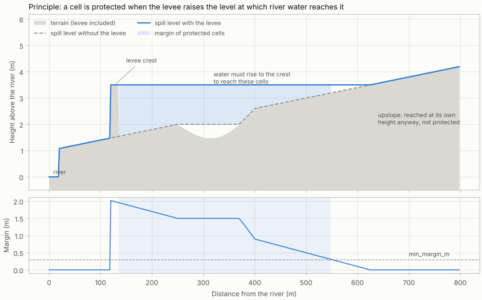

---

## Contents

1. [Running the scripts](#1-running-the-scripts)
2. [Repository layout](#2-repository-layout)
3. [Configuration](#3-configuration)
4. [Run order and outputs](#4-run-order-and-outputs)
5. [Method: from levee lines to protected areas](#5-method-from-levee-lines-to-protected-areas)
6. [Large DTMs: corridors, storage layout, units](#6-large-dtms-corridors-storage-layout-units)
7. [Parallel processing, checkpoints, merging](#7-parallel-processing-checkpoints-merging)
8. [River lines and water sources](#8-river-lines-and-water-sources)
9. [Return period index](#9-return-period-index)
10. [Observational evidence: Copernicus GFM](#10-observational-evidence-copernicus-gfm)
11. [Observed bounds of the return period: GloFAS and EFAS (Stage F)](#11-observed-bounds-of-the-return-period-glofas-and-efas-stage-f)
12. [Validation](#12-validation)
13. [Measured performance](#13-measured-performance)
14. [Tests](#14-tests)
15. [Bugs, fixes, limitations, open decisions](#15-bugs-fixes-limitations-open-decisions)
16. [Data sources and licences](#16-data-sources-and-licences)
17. [Stage D (in progress): industrial sites, dense urban areas, large systems](#17-stage-d-in-progress-industrial-sites-dense-urban-areas-large-systems)
18. [Stage E (experimental): implied protection in dense built-up reaches](#18-stage-e-experimental-implied-protection-in-dense-built-up-reaches)

---

## 1. Running the scripts

### 1.1 GUI

`pixi run gui` opens the **Defenses GUI**, an alternative to the shell for everyday work.


| Page | What it does |
|---|---|
| **Pipeline** | Every step as a card in run order: status, the outputs it has written, its run variables (`UNITS`, `FORCE`, `RUN_ID`…; they start from the values at the top of the script) and a Run button. The running step shows a progress bar on its card (units done, %, ETA; a moving bar for steps without units), also in the window title. **Run core pipeline** queues the core steps in order |
| **Console** (bottom) | Runs one step at a time from a queue, streams its output and shows the progress of the units (`[k/N]`, ETA), warnings and errors. **Stop** ends the step with its worker processes |
| **Results** | Protected areas (files A and B), leaks by cause with the largest places, levee lines on the crest, units, speed and extrapolated country time, the overview of the latest report, output files |
| **Configuration** | Form for the short `defenses.toml`: folders, workers, input files of each country with a check that they exist and a Browse dialog. The upstream area column is picked from the numeric columns of the rivers file. A Raw TOML tab edits the whole file. Saving keeps comments and layout (`gis.Config.set_toml_value`) and checks the TOML first |
| **Logs** | Run logs of the scripts with filters for warnings and errors, and search |

**Help.** A small **?** next to the items that need an explanation (run variables FORCE, Units, File, Run id, Hints; some steps; workers, the upstream area column and the river guide lines; three result tiles) opens a short bubble; a click elsewhere or Esc closes it.

**How it works.**
- **Standard library only.** `gui/app.py` is a small HTTP server; the page (`gui/static/`)
  opens in an app window of Edge or Chrome, or in the default browser. No new dependency.
- **Same runs as the shell.** Every step runs as `python -m <module>` in the pixi
  environment, with the run variables as `DEFENSES_<NAME>` environment variables. A run
  from the GUI therefore equals the same run from the shell.
- **Local only.** The server listens on `127.0.0.1` and accepts API calls only with a
  token created at start.
- **Closing.** **Quit** in the sidebar, or Ctrl+C in the terminal.

**Run variables of the GUI** (top of `gui/app.py`, or `DEFENSES_<NAME>`): `CONFIG_PATH`,
`PORT` (0 = any free port), `OPEN_WINDOW`.

**Tests.**
- **Server:** `pixi run test-gui`, 15 checks of the server on a synthetic setup:
  - security: token, host, paths outside the allowed folders;
  - state and script defaults, results, logs;
  - configuration editing (form with comments kept, raw text with invalid TOML refused);
  - path and column checks;
  - runs: queue, failure, console lines, progress and ETA, stop with the worker processes,
    cancel, clear;
  - folder and file dialog without errors;
  - quit, refused while a step runs unless forced.
- **Browser:** walked through every page and control with Playwright, with no JavaScript
  errors. That walkthrough is not part of the repository; it needs a browser driver.
- **Not tested on Windows:** the Browse dialog and the Edge app window (tests ran on Linux
  without a display).

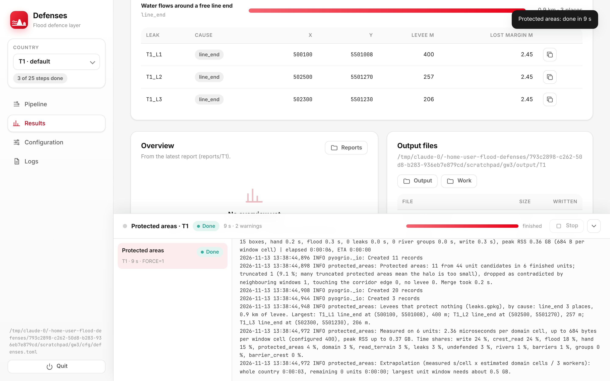

### 1.2 Shell

**No command-line parameters.** Each script starts with a block of *run variables*:

```python
CONFIG_PATH = "config/defenses.toml"
COUNTRY = "XX"
FORCE = False   # recompute finished units / footprint / conversion / extraction
UNITS = []      # protected_areas.py, rp_index.py, download_gfm.py, gfm_evidence.py: selected units, empty = all
```

`gfm_evidence.py` has three more: `HINTS` (missing-barrier hints, §10.3) and `DATE_FROM`,
`DATE_TO` (restrict the run to the scenes of one flood event).

Everything else comes from the TOML configuration: data paths, thresholds, resolutions,
URLs and tag lists. Code holds no paths, CRS, URLs or thresholds.

Batch runs and the tests override the run variables through environment variables named
`DEFENSES_<VARIABLE>`, for example `DEFENSES_COUNTRY=CZ` or
`DEFENSES_UNITS=012_034,012_035`. Without them the values in the script apply.

**Scripts run as modules from the repository root.** `python -m package.script` puts the
working directory on `sys.path`, so `import gis` works without `sys.path` manipulation or
packaging:

```
pixi run check              pixi run download-ghsl      pixi run download-gfm       pixi run test-kernels
pixi run prepare-dtm        pixi run rp-index           pixi run gfm-evidence       pixi run test-pipeline
pixi run build-units        pixi run download-worldcover pixi run download-discharge pixi run test-stage-b
pixi run protected-areas    pixi run hand-yz            pixi run discharge-prepare  pixi run test-stage-c
pixi run report                                         pixi run rp-bounds          pixi run test-hand-yz
                                                        pixi run validate           pixi run test-stage-f
```

`pixi run python -m processing.protected_areas` works the same way. Running a script by its
file path does **not** work, because Python then puts the script folder on the path
instead of the root.

**Dependencies** are listed in `pixi.toml`:
- `python ≥ 3.11` (for `tomllib` and `ProcessPoolExecutor(max_tasks_per_child)`),
- `gdal ≥ 3.11` (`MEM` vector datasets),
- `libgdal-netcdf`, `libgdal-grib`: GDAL's NetCDF and GRIB drivers, which conda-forge
  ships as separate plugin packages (GloFAS and EFAS files),
- `numpy`, `scipy`, `numba`, `geopandas ≥ 1.0`, `shapely ≥ 2.0`, `pyproj`,
- `pandas ≥ 2.0` (already used by `gis.py`; 2.0 for ISO 8601 date parsing),
- `pyflwdir`, only because the existing `gis.py` imports it (it depends on affine,
  numba, numpy and scipy, not on rasterio).

Downloads and the STAC search use the standard library (`urllib`). No rasterio-based
library is used. Two further dependencies were approved:
- `cdsapi` for the EWDS downloads of `download_discharge.py` (Stage F). With
  `ewds_api_url = "file:///…"` the script copies files downloaded by hand instead (§11.2);
- `matplotlib-base` for the plots of Stages E and F.

## 2. Repository layout

```
gis.py                     shared GIS library (existing; new functions appended, nothing changed)
plots.py                   plotting helpers of Stages E and F (matplotlib): budget, saving, colours, index.html
config/defenses.toml       settings of a run: country, folders, input paths (short; you fill it)
config/advanced.toml       all other keys with their defaults
docs/navod_cs.md           short guide to running the scripts, in Czech
docs/make_figures.py       explanatory figures of this README (docs/img/), from synthetic data
docs/stage_d_plan.md       Stage D, step D.1: inventory, inputs, plan and measured runtime impact
docs/stage_e_plan.md       Stage E, step E.2: outputs check, corridor read benchmark, plan (approved)
gui/
  app.py                   Defenses GUI: local server, job queue, configuration editing (pixi run gui)
  static/                  page of the GUI: index.html, style.css, app.js, logo.svg
download/
  download_ghsl.py         GHSL building volume tiles -> VRT mosaics
  download_gfm.py          GFM scene search (STAC), screening, clipped layers per unit
  download_discharge.py    GloFAS and EFAS requests to the EWDS (cdsapi), resume, upstream area files (Stage F)
  download_worldcover.py   ESA WorldCover tiles over the corridor -> worldcover.vrt
  download_clms.py         CORINE (legend mapping verified on known pixels) and Urban Atlas from local files
processing/
  check_inputs.py          configuration and input check before a run (pixi run check)
  data_report.py           compact report of inputs, outputs and logs into reports/<country>/ (pixi run report)
  prepare_dtm.py           DTM inspection, footprint, benchmark, estimates, optional conversion
  build_units.py           river corridor, processing units, memory estimate
  protected_areas.py       per-unit protected areas in parallel, checkpoints, merging; files A and B, leaks
  rp_index.py              exposure, score, RP per protected area
  HAND_YZ.py               land cover exposure (WorldCover, Urban Atlas) supplementing GHSL
  context_zones.py         industrial / dense urban / urban / rural zones of the corridor (Stage D)
  snap_rivers.py           river lines snapped to the thalweg, river points with chainage (Stage E1)
  implied_segments.py      bank subsegments: envelope, nearest river point, side, chainage bins (Stage E2)
  implied_protection.py    built-up fraction, HAND curves and levels per subsegment (E3), implied protected areas (E4)
  implied_evaluate.py      sensitivity grid, recall of built area and wet built area inside implied protected areas (E5)
  gfm_evidence.py          held / flooded tests per protected area and scene; missing-barrier hints
  discharge_prepare.py     daily series per river cell, annual maxima, Gumbel fits (Stage F)
  rp_bounds.py             matching to discharge cells, event return periods, source combination, bounds
  validate.py              area recall and precision; RP confusion matrix (was validate_defenses.py)
  transport_embankments.py road and railway embankments from the DTM, their openings (Stage G step 3)
  flood_events.py          flood events per river group from the discharge series (Stage H step 2)
  event_composites.py      GFM scenes of every event combined per unit (Stage H step 3)
tests/
  test_kernels.py          numba kernels on small grids (22 checks)
  test_pipeline.py         end-to-end synthetic countries for Stage A and G (45 checks)
  test_stage_b.py          end-to-end synthetic country for Stage B (18 checks)
  test_stage_c.py          end-to-end Stage C on the Stage B country (28 checks)
  test_hand_yz.py          land cover exposure on the Stage B country (8 checks)
  test_stage_d.py          Stage D on the Stage B country, country code T4D (D1: 10 checks)
  test_stage_e.py          Stage E on its own synthetic country T5 (E1: 16, E2: 6, E3: 7, E4: 8, E5: 7 checks)
  test_stage_f.py          Stage F on its own synthetic country T6 (16 checks)
  test_gui.py              server of the GUI on a synthetic setup (15 checks)
  test_transport.py        transport embankments on a synthetic country T7 (15 checks)
  test_stage_h.py          Stage H: event catalogue and event composites on synthetic data (16 checks)
  make_benchmark_world.py  24 x 24 km synthetic DTM for performance runs
download_nld.py            US National Levee Database download (optional)
```

### New `gis.py` functions

Functions are appended to the existing classes or added as new classes; no existing
function was modified. The only change to existing lines is the import block.

| Class | Function | Purpose |
|---|---|---|
| `Raster` | `inspect`, `build_vrt` | Storage properties of a raster; VRT over several DTMs (stops on a CRS mismatch) |
| `Raster` | `read_window(src, bounds, res, resample, warp_mb, overview, multithread, dst_wkt, src_nodata)` | `gdal.Warp` of a map window to MEM, optionally reprojected; `src_nodata` overrides the file's nodata (GFM layers) |
| `Raster` | `read_native(src, bounds)` | Direct read of native pixels |
| `Raster` | `array_to_mem`, `write_array`, `best_compression` | Array ↔ GDAL; tiled compressed GeoTIFF; ZSTD → DEFLATE fallback |
| `Raster` | `rasterize_geometries`, `polygonize_labels`, `fill_nodata_cells`, `footprint` | Burn geometries; label raster → polygons; `gdal.FillNodata` on selected cells; valid-data footprint |
| `Raster` | `benchmark_reads(info, polygon, …)`, `map_codes(values, mapping)` | Read benchmark of one raster, shared by DTM and DSM; raster values → codes through a lookup (CORINE legend) |
| `Vector` | `check_single_layer`, `read_merged`, `write_gpkg`, `length_near_boundary` | Single-layer inputs; merged reads with `source`; single-layer GeoPackage output; levee length near protected area boundaries |
| `Vector` | `layer_names`, `single_layer_copy(path, layer, out_path)` | Layers of a vector source; one layer of a multi-layer source copied to its own GeoPackage with `gdal.VectorTranslate` |
| `Vector` | `zones_to_grid(zones, order, shape, geotransform, wkt)` | Context of every cell of a unit grid (position in `context.order`, 0 = none) |
| `Hydro` | `breach_to_streams(dem, stream, burn, burn_buffer_cells)` | River cell reached downstream (numba) |
| `Hydro` | `priority_flood(surface, seeds)` | Spill level, seed index and reach order per cell (numba) |
| `Hydro` | `distance_cells(mask, limit)` | Chamfer distance in cells (numba) |
| `Config` | `load`, `get`, `as_list`, `warn_placeholders` | TOML reading and validation |
| `Run` | `env_overrides`, `logger`, `peak_rss_mb`, `configure_gdal`, `run_units`, `format_seconds` | Run variables, run logs, memory measurement (Linux/macOS/Windows), process pool |
| `Http` | `download(url, path, retries, pause_s, headers)` | urllib download with size check, skip and backoff; `file://` supported |
| `Http` | `get_json(url, params, body, retries, pause_s, headers)` | JSON GET with query parameters or POST of a JSON body, with backoff (STAC search and its `next` links) |
| `Stats` | `percentile_rank`, `quantile_classes` | Ranks and quantile mapping for the RP score |
| `Stats` | `gumbel_lmoments(sample)`, `gumbel_rp(q, xi, alpha)` | Gumbel fit by L-moments; return period of a discharge |
| `Hydro` | `least_cost_path(cost, start, end)` | Dijkstra on an 8-connected grid (numba), NaN impassable; thalweg snapping |
| `Hydro` | `hand_above_streams(dem, stream, burn, burn_buffer_cells, valid)` | HAND code path of `protected_areas.py`, moved here so that Stage E recomputes HAND the same way |
| `Vector` | `chaikin(line, iterations, max_shift)`, `interpolate_xy(line, distances)` | Chaikin smoothing that keeps vertices which would move more than `max_shift`; points along a line in one numpy pass |
| `Raster` | `hillshade(array, geotransform, wkt)` | Hillshade with `gdal.DEMProcessing` to MEM (plots) |
| `Stats` | `binned_quantiles(area, edges, quantiles)`, `onset(share, smooth_bins, fraction, persist_bins)`, `sharpness(smoothed, onset_bin, window_bins)` | Area-weighted quantiles within bins; onset and sharpness of a built-share curve (Stage E) |
| `Stats` | `merge_levels(k, eligible, level, max_dlevel, max_gap)` | Groups of subsegments along a river side, short gaps bridged (Stage E) |
| `Evidence` | `scene_masks`, `comparison_zones`, `outcome`, `test_regions` | GFM tests of regions, moved from `gfm_evidence.py`; Stage E tests implied protected areas with them |
| `Discharge` | `band_times(ds)`, `period_days(valid_seconds, marks)` | Valid time of every GRIB or NetCDF band (an ambiguous NetCDF layout stops); day of the averaging period for end or start marks (Stage F) |
| `Discharge` | `aggregate_daily(days, values, how, steps_per_day)`, `annual_maxima(days, values, start_month)`, `gumbel_fits(maxima, min_years)` | Daily mean or maximum of sub-daily steps (incomplete days NaN); maxima of complete hydrological years; Gumbel fits with the RMSE at Gringorten positions |
| `Discharge` | `match(lon, lat, river_area_km2, cell_lon, cell_lat, cell_area_km2, radius_km, ratio_min, ratio_max, same_river)` | Discharge cell of a river location: radius and ratio, same river first, then ratio, then distance |
| `Stats` | `gumbel_q(rp, xi, alpha)` | Discharge of a return period (inverse of `gumbel_rp`) |
| `Config` | `MIGRATIONS`, `DEFAULTS` | Old keys read under their new names with a warning (Stage C GloFAS keys); values of optional keys |

### Naming in the code

All scripts and tests name their variables by one scheme:
- **Prefixes:** `gdf_…` for GeoDataFrames, `df_…` for DataFrames, `list_…` for lists.
- **Spatial joins:** `gdf_sjoin_<a>_<b>`, for example `gdf_sjoin_src_rn` (river sources joined to the rivers).
- **Short abbreviations:**
  - `rn` rivers, `lv` levees, `bl` barrier lines, `br` bridges, `bar` barriers with crest heights;
  - `pa` protected areas, `fp` footprints, `poly` polygons, `win` and `core` unit windows and cores;
  - `ua` Urban Atlas, `ev` GFM evidence, `ovr` overrides.

In `gis.py` the scheme applies to the local variables of the functions added for this package. The original
functions and all function parameters are unchanged.

## 3. Configuration

The configuration has two files:
- **`config/defenses.toml`** holds only what you set:
  - the country of the runs (`[general] country`), the folders and the number of workers;
  - the input paths of the country (`[countries.<code>]`): DTM, levees, rivers, the
    upstream area column, optional guide lines for the rivers;
  - the damage tables.
- **`config/advanced.toml`** holds every other key with its default value and normally
  stays unchanged.
  - **Merging.** A key written in `defenses.toml` overrides the same key in
    `advanced.toml`. Tables of the schema type "table" (EWDS requests, URL templates) are
    replaced whole.
  - **Country defaults.** The table `[country_defaults]` and its sub-tables apply to every
    country; `[countries.<code>…]` overrides them key by key.
  - **Optional.** Without `advanced.toml` next to it (as in the tests), `defenses.toml` is
    read alone and must then hold all keys.
- **Country of a run.** It comes from `[general] country` when the script's `COUNTRY`
  stays `"XX"`; `DEFENSES_COUNTRY` still overrides it.
- **Check before a run.** `pixi run check` (`processing/check_inputs.py`) validates the
  keys of every core and optional script and opens the inputs:
  - DTM size, resolution and CRS;
  - one layer per vector file, CRS, the upstream area column;
  - the guide lines, the damage tables, write access to the folders.

  It prints OK or PROBLEM per item and exits with 1 when a core step is blocked.
- **Report after a run.** `pixi run report` (`processing/data_report.py`) writes a summary
  to `reports/<country>/` in the repository, meant to be committed:
  - **`report.md`** (cut at 60 KB):
    - the configuration in use;
    - DTM storage and elevation statistics from 24 random windows;
    - levees and rivers inside the DTM footprint (counts, lengths, columns);
    - every output layer and table (counts, areas, percentiles, the largest features);
    - **Stage H checks:** discharge series per source (cells, period, missing values, Gumbel
      fit quality, the days with most cells above RP 10 since the first GFM scenes: do
      known floods fall on the right dates?); river groups with a discharge cell; events
      per year; GFM screening; the 15 largest events with the GFM scene windows in their
      window (count, acquisition days, first and last day relative to the peak); the
      maximum flood extent files;
    - the newest log of every script (distinct warnings and errors, last lines);
  - **`overview.png`:** the footprint, the levees and the protected areas.

  It reads samples and summaries only and never copies data.

The tables of `advanced.toml`:
- `[general]`: directories, workers, memory limits, GDAL cache and threads.
- `[benchmark]`: benchmark windows.
- `[country_defaults]` (in `defenses.toml`: `[countries.<code>]`): inputs, resolutions,
  units and conversion, with sub-tables `protected_areas` and `rp`. Old configurations with
  the sub-table `compartments` are read as `protected_areas`, with a warning.
- `[river_snap]`: snapping of the rivers into their channel (§8).
- `[sources]`: download templates, tag lists, retries.
- `[evidence]`: Stage C.
- `[implied]`: Stage E (§18).
- `[discharge]`, `[discharge.glofas]`, `[discharge.efas]`: Stage F (§11).

**Keys only in `gis.Config.DEFAULTS`** (not in the toml files): `river_groups.*` (§8.3),
`levee_snap.*` (§5.8), `levee_gaps.*` (§5.9) and `leaks.sample_spacing_m` (§5.10). A
table of the same name in `defenses.toml`, e.g. `[levee_snap]` with `max_shift_m = 0.0`,
overrides them.

All path keys accept a string or a list. Every script validates exactly the keys it uses,
before doing any work:
- **presence and type;**
- **file existence;**
- **allowed values;**
- **consistency between keys:**
  - share sums and list lengths;
  - `distribution_classes`, `cap_rp` and `max_rp` must be values of `classes`;
  - `unit_halo_m ≥ corridor_buffer_m` (reason in §6.4).

All problems are listed in one message and the script stops.

**Placeholders.** The top-level array `placeholders` lists keys whose values are not
confirmed yet. Every script logs a warning for each placeholder it uses.

**Migration of the Stage C GloFAS keys (Stage F).** A configuration with the old keys keeps
working.
- **Read under the new names, with a warning** (`Config.MIGRATIONS`):

  | Old key | New key |
  |---|---|
  | `sources.glofas_dataset_id`, `glofas_request`, `glofas_time_keys`, `glofas_area_key`, `glofas_first_year`, `glofas_last_year` | `discharge.glofas.*` without the prefix |
  | `sources.glofas_discharge_variable` | `discharge.glofas.netcdf_variable` |
  | `sources.glofas_upstream_area_file`, `glofas_upstream_area_variable`, `glofas_upstream_area_to_km2`, `glofas_min_upstream_area_km2` | `discharge.glofas.upstream_area_*`, `min_upstream_area_km2` |
  | `evidence.glofas_search_radius_km`, `upstream_ratio_min`, `upstream_ratio_max` | `discharge.glofas.search_radius_km`, `upstream_ratio_min`, `upstream_ratio_max` |
  | `evidence.flooded_window_days` | `discharge.flooded_window_days` |

- **Replaced:**
  - `glofas_min_days_per_year` by the complete-year rule (§11.4);
  - `glofas_valid_time_ends_day` by `valid_time_marks`;
  - `glofas_files` and `glofas_file_extension` by the local mode
    `ewds_api_url = "file:///…"` and `data_format`;
  - `glofas_upstream_area_url` by `upstream_area_file`.

Every source table needs all its keys, including a source that `sources` does not list.

Keys beyond the original schema, with the reason for each:

| Key | Reason |
|---|---|
| `general.gdal_threads_per_worker` | Avoid oversubscription: n workers × GDAL threads ≤ cores |
| `benchmark.*` | Window count, size and seed of the benchmark (reproducible positions) |
| `country.dtm_conversion`, `dtm_compress`, `footprint_resolution_m` | DTM conversion (§6.3) and footprint |
| `country.bytes_per_cell` | Memory model for unit sizing; replace with the value logged by `protected_areas.py` |
| `country.crest_box_size_m` | Size of the boxes read at native resolution around levees |
| `country.merge_overlap_ratio`, `drop_contradicted_truncated`, `contradiction_ratio`, `id_rounding_m` | Merging of units and ids (§7.3) |
| `country.keep_intermediate` | Write DTM, spill, margin, barrier and crest rasters per unit |
| `protected areas.touch_tolerance_m`, `self_close_min_length_factor` | Former code constants of the bridging |
| `protected areas.gated_crossings`, `fill_nodata_holes` | Former command-line switches |
| `protected areas.stream_burn_m`, `stream_burn_buffer_m` | B1 fix (§15.1) |
| `protected areas.preserve_river_cells` | B2 fix |
| `protected areas.cap_river_holes`, `max_fill_distance_m` | Gap filling for water surfaces (§5.5) |
| `rp.value_total_tolerance` | Tolerance of the value-warp totals check (spec: 1 %) |
| `sources.request_pause_s`, `max_retries` | Polite downloads with backoff |
| `sources.ghsl_url_templates` (table `total`, `non_residential`), `ghsl_tile_schema`, `ghsl_tile_field`, `ghsl_nodata_as_zero` | GHSL tiles; a table instead of the list in the original schema, so that products cannot be swapped |
| `country.validation_extent` | Optional area where the reference is complete; recall and precision outside it are meaningless |
| `sources.gfm_collection`, `gfm_assets` (table `flood`, `exclusion`, `reference_water`, `likelihood`), `gfm_page_limit`, `gfm_token_env` | STAC collection, asset keys per role, page size, name of the environment variable holding an access token (never the token itself) |
| `sources.gfm_screen_resolution_m`, `gfm_download_threads` | Resolution of the screening read; scenes screened at the same time (§10.1) |
| `sources.gfm_flood_values`, `gfm_exclusion_values`, `gfm_reference_water_values`, `gfm_nodata_values` | Pixel codes of the GFM layers; placeholders until checked against the product description |
| `discharge.<source>.download_format`, `time_keys`, `area_key` | Parameters of the EWDS form whose names or values the form shows; the script adds time and area under these names (§11.2) |
| `discharge.<source>.step_hours`, `valid_time_marks` | Steps per day and the time convention of the files (§11.3) |
| `discharge.<source>.netcdf_variable`, `upstream_area_variable`, `upstream_area_to_km2` | Variables of the NetCDF files and the unit of the upstream area map |
| `evidence.river_level_percentile`, `hint_margin_m`, `hint_dry_share`, `hint_min_scenes`, `hint_exclusion_m` | Missing-barrier hints (§10.3); the specification fixed 90 % and "most scenes" in words |
| `country.lulc.*` (table) | Land cover exposure of `HAND_YZ.py` (§9.3): switch, WorldCover and Urban Atlas inputs, class-to-category mappings, values and curves per category |
| `sources.worldcover_url_template`, `worldcover_grid_url`, `worldcover_tile_field`, `worldcover_version`, `worldcover_year` | ESA WorldCover tiles (§9.3); verified |
| Stage D tables (`[countries.XX.context]`, `[countries.XX.context.params.<context>]`, `[crest_lines]`, `[barriers]`, `[coarse]`, `[review]`) and inputs (`dsm`, `building_footprints`, `manual_barriers`, `industrial_registry`, `ems_flood_extents`, `water_polygons`) | As specified for Stage D (§17) |
| `country.corine`, `corine_legend`, `corine_legend_index_field`, `corine_legend_code_field`, `corine_check` | CORINE from local files: the legend maps class indices to codes, verified on known pixels |
| `sources.ghsl_url_templates.smod`, `.pop` | Optional GHSL settlement model and population (Stage D) |

## 4. Run order and outputs

| Step | Script | Writes (`output_dir/<country>/` unless noted) |
|---|---|---|
| 1 | `prepare_dtm.py` | `dtm_inspection.csv`, `dtm_footprint.gpkg`, `dtm_benchmark.csv`, `dtm_estimates.json`, `work/<c>/dtm/dtm.vrt` |
| 2 | `build_units.py` | `corridor.gpkg`, `units_core.gpkg`, `units_window.gpkg`, `units.csv`, `work/<c>/units_domain.gpkg` |
| 3 (optional) | `prepare_dtm.py` with `convert_dtm = true` | tiled copies in `work/<c>/dtm/`; `dtm.vrt` repointed to them |
| 6 | `protected_areas.py` (first two units, then all) | `rivers_channel.gpkg`, `river_groups.gpkg`, `levees_crest.gpkg`; per unit in `work/<c>/units/<id>/`: `hand_undef.tif`, `labels.tif`, `protected_areas.gpkg`, `protected_areas_by_group.gpkg`, `leaks.gpkg`, `barrier_crest.csv`, `done.json`, `unit.log`; merged: `protected_areas.gpkg` (file A), `protected_areas_by_group.gpkg` (file B), `leaks.gpkg`, `barriers.gpkg`, `enclosed_streams.gpkg`, `performance.json` |
| 6a (optional) | `transport_embankments.py` (needs `transport_lines`) | `transport_embankments.gpkg`, `openings.gpkg`, `plots/transport/<RUN_ID>/` |
| 7 | `download_ghsl.py` | `ghsl_total.vrt`, `ghsl_non_residential.vrt`, `ghsl_sources.json` |
| D1 (Stage D) | `prepare_dtm.py` with `dsm`; `download_ghsl.py` with `smod`, `pop` | `dsm_inspection.csv`, `dsm_benchmark.csv`, `dsm_footprint.gpkg`; `ghsl_smod.vrt`, `ghsl_pop.vrt` |
| D1 (Stage D) | `download_clms.py`, then `context_zones.py` | `corine_codes.tif`, `urban_atlas.gpkg`, `clms_sources.json`; `zones.gpkg` |
| 7a (optional) | `download_worldcover.py` | `worldcover.vrt`, `worldcover_sources.json`; tiles in `work/<c>/worldcover/` |
| 7b (optional) | `HAND_YZ.py` | per unit `hand_yz.csv`, `hand_yz.json`; merged `exposure_lulc.csv` |
| 8 | `rp_index.py` | per unit `rp_index.csv`, `rp_index.json`; merged `protected_areas_rp.gpkg` (with `value_ghsl`, `value_lulc`) |
| 9 | `download_gfm.py` | `work/<c>/gfm/screening.csv` (checkpoint), clipped layers in `work/<c>/gfm/<unit>/`, `gfm_index.csv` |
| 10 | `gfm_evidence.py` | per unit `gfm_evidence.csv` (and `missing_barrier_hints.gpkg`); merged `gfm_evidence.csv`, `gfm_evidence.gpkg`, `missing_barrier_hints.gpkg` |
| 11 | `download_discharge.py` | raw files in `work/<c>/discharge/raw/<source>/`, `download_log.csv`, `discharge_sources.json` |
| 12 | `discharge_prepare.py` | `discharge_<source>.npz`, `discharge_cells_<source>.gpkg`, `plots/discharge/prepare/` |
| 13 | `rp_bounds.py` | `event_rp.csv`, `event_rp_combined.csv`, `discharge_matches.gpkg`; `protected_areas_rp.gpkg` updated: matches per source, observed bounds, combined `rp`, `*_prior` model values; `plots/discharge/<RUN_ID>/` |
| 13a (Stage H) | `flood_events.py` | `events.gpkg`, `event_groups.csv`, `plots/events/<RUN_ID>/` |
| 13b (Stage H) | `download_gfm.py` again, then `event_composites.py` | dry scene windows (`event_dry`); `work/<c>/events/<event_id>/`, `event_composites.csv`, `max_extent_comparison.csv` |
| 14 | `validate.py` | `validation.json`, `validation_coverage.gpkg`, `validation_rp_confusion.csv` |

Run logs go to `output_dir/<country>/logs/<script>_<timestamp>.log`.

**Notes on the order:**
- `protected_areas.py` snaps the rivers into their channel once per country
  (`rivers_channel.gpkg`, §8) and uses them as water sources.
- **`protected_areas.gpkg` columns:** `protected_area_id`, `area_m2`, `protection_level_m`,
  `margin_median_m`, `margin_max_m`, `river_ref_median_m`, `entry_x`, `entry_y`,
  `source_x`, `source_y`, `truncated`, `touches_corridor_edge`, `touches_dtm_edge`,
  `no_levee`, `unit_id`, `unit_label`, geometry.
- **Added columns:** `touches_dtm_edge` (B3) and `unit_label`, which points to the
  protected area's cells in the unit's `labels.tif`.
- **`protected_areas_by_group.gpkg`** (file B, §8.3) has the same columns plus
  `group_id`; its ids end with `_g<group>`. Its `unit_label` points into the group's own
  `groups/labels_g<group>.tif` of the unit.
- **Downstream steps for file B:** set `LAYER = "B"` (§8.4).

## 5. Method: from levee lines to protected areas

### 5.1 Principle

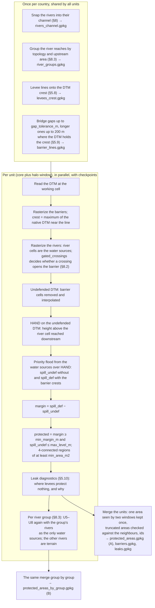

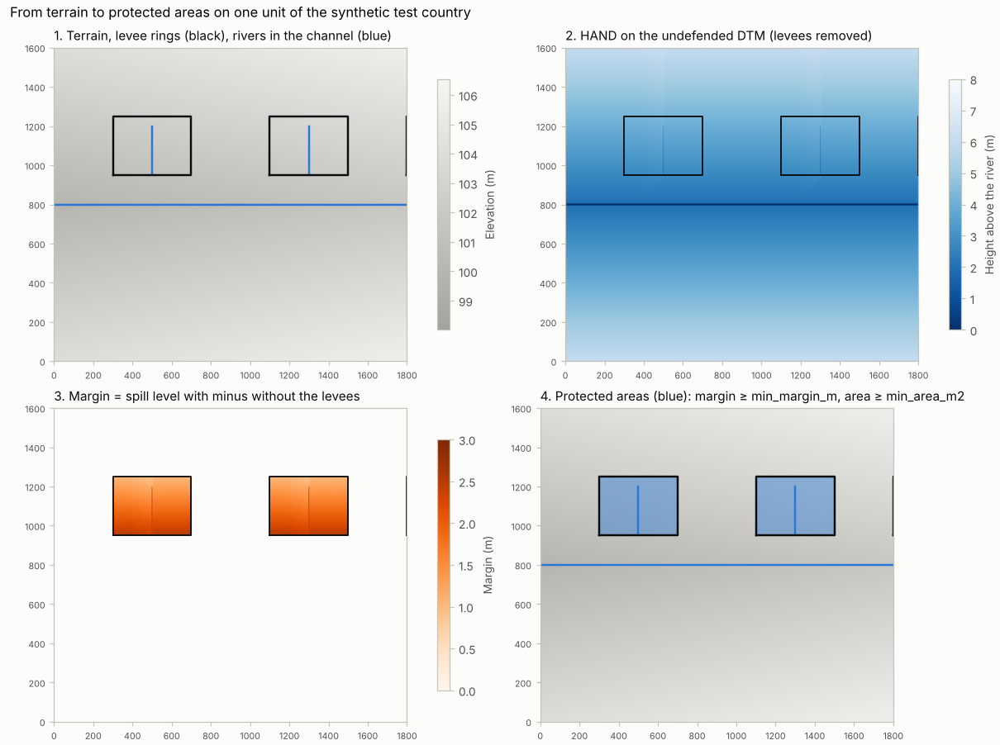


A levee protects an area if water from the river has to rise **higher** to reach that
area with the levee than without it. Both cases are computed on the same
height-above-river surface:

* `hand_undef` (Height Above Nearest Drainage on the *undefended* DTM): the elevation of
  a cell minus the elevation of the river cell its drainage path reaches (`river_ref`).
* **Spill level** of a cell: the lowest level above the river at which water starting at
  any river cell reaches the cell, moving between 4-neighbours. It is computed by a
  priority flood (Dijkstra with the max-operator):
  `spill(n) = min over paths of max(surface along the path)`, from 0 at river cells.
  Cells leave the queue in increasing spill order, so each cell is final at first
  removal.
* `spill_undef`: the flood over `hand_undef`. `spill_def`: the same flood over the
  *defended surface*, which equals `hand_undef` except on barrier cells, where it is
  `max(crest − river_ref, hand_undef)`.
* `margin = spill_def − spill_undef ≥ 0`. A cell is **protected** if
  `margin ≥ min_margin_m` and `spill_undef ≤ max_level_m`.
* 4-connected protected regions are protected areas; regions smaller than `min_area_m2` are
  dropped. **`protection_level_m`** is the minimum `spill_def` in the protected area: the
  level above the river at which water first enters.

Consequences that look odd at first but are correct:
- **Upslope parts are not protected.** Parts of a ring that lie higher than its lowest
  crest are not protected, because water would reach them at their own height anyway.
- **Nested rings.** The inner protected area of nested rings has the higher of the two
  crests as its protection level (tested in both orders).

### 5.2 Barriers

1. **Merging.** All levee files are read, reprojected and split into single lines;
   `source` holds the file stem. Snapping, bridging and line ids are computed **once per
   country** (`levees_crest.gpkg`, `work/<c>/barrier_lines.gpkg`), so all units see
   identical barriers.
2. **Lines onto the crest** (§5.8): every line is moved onto the crest seen in the DTM,
   within 15 m.
3. **Bridging** (vectorised with a spatial index):
   - **Rule.** Each endpoint with another line within `gap_tolerance_m` is joined to the
     nearest such line: to its endpoint if one is within the tolerance, otherwise to its
     nearest point (T-junctions).
   - **Longer gaps** up to 200 m are bridged only where the DTM holds the crest along the
     gap (§5.9).
   - **Already connected.** Endpoints within `touch_tolerance_m` of another line count as
     connected.
   - **Self-closing.** A single line whose own ends are within the tolerance closes on
     itself if it is longer than `self_close_min_length_factor × gap_tolerance_m`.
4. **Rasterization** on the working grid uses `ALL_TOUCHED`. Diagonal-only contacts are
   then closed by adding the higher corner cell. A 4-connected flood cannot pass between
   two cells touching only at a corner anyway; the closing also guarantees that a river
   crossing a staircase levee cuts a barrier cell.
5. **Crest elevation** is the maximum of the *native* DTM near the line, because line
   geometry can be offset from the real crest:
   - **Where native pixels are read.** Only in boxes of `crest_box_size_m` around the
     levees; boxes in one row separated by at most one empty box are read together.
   - **How each box is read.** `gdal.Warp` with `resampleAlg = "max"` and **overviews
     disabled**, because `AVERAGE` overviews would lower the crest.
   - **Search radius.** A circular maximum filter with `crest_search_radius_m` follows.
     The effective search radius is up to one working cell larger than configured, which
     favours recall.
6. **Bridged cells** get crests interpolated linearly along the bridge between the crests
   at its ends.
7. **Rivers crossing barriers.** By default the river wins: crossing cells are not
   barrier. With `gated_crossings = true` crossings stay closed (§8.2).

### 5.3 Undefended DTM

All barrier cells, dilated by `barrier_removal_width_m`, are set to nodata and
interpolated with `gdal.FillNodata`. **River cells** inside that zone keep their
elevation, because they are the river bed (B2, `preserve_river_cells`). Only river cells
that cross a levee are interpolated, because there the DTM shows the levee body.

### 5.4 HAND on the undefended DTM

1. **Stream cells** are the water-source rivers rasterized along their centre line (not
   all-touched), so that rivers cut as few barrier cells as possible.
2. **Flow routing** runs on a *conditioned copy* of the undefended DTM:
   - **Tapered stream burning** (B1): river cells are lowered by `stream_burn_m`,
     decreasing linearly to 0 at `stream_burn_buffer_m` (chamfer distance). This gives
     every channel cell a gradient towards the rasterized river; without it, D8 paths
     run along the channel and reach the river only at its lowest point (§15.1).
   - **Complete breaching:** a priority flood from the river cells. A pit is carved back
     towards the outlet and then processed through a plain queue, because it lies below
     every queued cell. Flats get an ε gradient (1e-5 m).
   - **D8 steepest descent** on the conditioned surface. Receivers are always lower, so
     paths are acyclic; the river cell reached is resolved in O(n) by walking and
     assigning paths.
3. **`river_ref`** is the elevation of the river cell reached, from the *unconditioned*
   undefended DTM. `hand_undef = dtm_undefended − river_ref`.
4. **Fallback.** Cells not connected to any river cell take the nearest river cell; their
   number is logged.
5. **Only modelled water-source rivers are outlets**, so side catchments are routed
   (carved) to a modelled river. Every cell gets the reference of a river that the hazard
   maps contain.

### 5.5 Nodata in the DTM: coverage edge versus water surfaces

Lidar DTMs often have nodata on water surfaces. The two kinds of nodata must be treated
differently:

* **Missing coverage** (beyond the survey area) is unknown terrain. It stays nodata and
  acts as a wall. Protected areas next to it are kept (recall) and flagged
  **`touches_dtm_edge`** (B3).
* **Gaps inside the coverage** (water surfaces, data gaps) are interpolated. Otherwise a
  river surveyed as nodata would have no river cells, no water sources and therefore no
  protected areas at all.

**Telling them apart.** The coverage is the **morphological closing** of the valid DTM
cells with radius `max_fill_distance_m`, computed with two chamfer distance passes, so
the cost does not depend on the radius:
- **What it does:** it closes gaps narrower than twice the radius, including a gap where
  a river crosses the coverage edge, but does not move a straight coverage edge.
- **Window border:** the data mask is padded with "no data" before the closing, so a
  coverage edge near the window border is not closed against the border.
- **Search distance:** gaps are filled by `gdal.FillNodata` with a search distance equal
  to the largest gap half-width.

**Water surfaces** (`cap_river_holes`), i.e. gaps crossed by a river:
- **River cells** are interpolated **along each river line** between the nearest valid
  river cells (the river profile).
- **Where no river cell is valid in the window** (the whole river is nodata), and for the
  other cells of such gaps, the fill is capped at the lowest valid cell within reach:
  the waterline. Interpolation from the banks alone would lie above the water level;
  in a test this raised `river_ref` by about 1 m and produced a spurious protected area.

Test T3 makes the whole river nodata and checks that the result equals the one with a
complete DTM.

### 5.6 Seeds, entry and source

The priority flood also returns, for every cell:
- **the seed** (river cell) where its minimal spill path starts,
- **the order** in which cells were reached.

For each protected area:
- **`entry_x`, `entry_y`:** the protected area cell reached first by the defended flood,
  i.e. where water enters. Taking the cell with the minimal `spill_def` would be
  ambiguous, because every cell below the crest has the same spill level; the reach
  order resolves this.
- **`source_x`, `source_y`:** the seed of the entry cell, i.e. the river cell whose water
  enters first. Stage F matches it with GloFAS and EFAS upstream areas.

### 5.7 Flags

| Flag | Meaning |
|---|---|
| `truncated` | Touches the edge of the unit window, where it may continue (§7.3) |
| `touches_corridor_edge` | Adjacent to cells outside the processing domain (corridor + halo) |
| `touches_dtm_edge` | Adjacent to missing DTM coverage, which closes it as a wall |
| `no_levee` | No barrier line within `levee_adjacent_distance_m` of its boundary |

### 5.8 Levee lines onto the crest

Levee lines (OSM or other sources) often lie a few metres beside the crest seen in the DTM.
The crest search radius (5 m) then misses the crest, and the removal zone of the undefended
DTM (10 m) leaves part of the levee in place: both lower the margin. `protected_areas.py`
therefore moves the lines onto the crest once per country (`gis.Hydro.snap_to_crest`) and
writes **`levees_crest.gpkg`**.

1. **Profiles.** Vertices every 10 m; at each, a profile across the line every native
   pixel, 45 m to both sides. The DTM is read in blocks of 2048² pixels, only where
   vertices lie, in an order that reads each block about once.
2. **Crest.** The highest cell within 15 m of the line. Of the cells within 0.1 m of it,
   the nearest to the line is taken, so a line already on a flat crest does not move.
3. **Ridge test.** The crest must stand at least 0.5 m above the lowest cell within 30 m
   on both sides. Vertices without a ridge take the offset interpolated from their
   neighbours.
4. **Smoothing.** A running median of 5 vertices removes single jumps.
5. **Connectivity.** Ends shared by several lines move to the mean of their positions,
   so connected lines stay connected. Lines in which nothing moves keep their geometry.

**Columns of `levees_crest.gpkg`** (also in `barriers.gpkg`):
- `ridge_share`: share of vertices on a ridge;
- `crest_height_m`: median height of the ridge above the higher side;
- `shift_median_m`: median shift of the vertices;
- `no_ridge`: ridge on less than half of the line. Such lines are not visible as levees
  in the DTM. They may be mapping errors, embankments that are not levees, or levees the
  DTM does not resolve.

**Rerun.** The file is reused until you run with `FORCE`, as `rivers_channel.gpkg` is.

**Test** (pipeline, ring M): a line 8 m inside its 3 m wide embankment moves onto the
crest (median 2 m from the axis, within one pixel of the top). Without the move the ring
protects nothing and the leak diagnostics report `terrain_above_crest`.

### 5.9 Longer gaps verified by the DTM

Gaps longer than `gap_tolerance_m` are often missing pieces of a mapped levee that exists
in the terrain. Unbridged, they leak twice:
- **No barrier.** The gap has no barrier line.
- **Removal holes.** The removal zone of the undefended DTM eats `barrier_removal_width_m`
  into the levee body beyond each line end, and the defended surface shows these holes too.

**Rule.**
- **Candidates.** A free end (not touching another line) gets candidates up to 200 m away,
  in order of distance: the nearest point of every other line.
- **Profile.** For each candidate, `gis.Hydro.bridge_profile` takes the highest DTM cell
  within 15 m across the gap, every native pixel along it.
- **Acceptance.** The first candidate whose profile never drops more than 0.5 m below the
  lower of its two ends, and whose crest stands at least `levee_snap.min_height_m` above
  the terrain within `levee_snap.side_m` on both sides along the whole gap, is bridged.
  High ground alone is not a levee: without the ridge condition the first POL run bridged
  33,997 gaps, more than one per levee line.
- **Geometry.** The bridge then follows the crest between its fixed ends.
- **Output.** These bridges have `bridge_type = "dtm"` in `barriers.gpkg`; bridges within
  `gap_tolerance_m` have `"short"`.

A gap without a levee body in the DTM (a road at grade, a river, a missing piece of the
levee) is not bridged. It stays an opening and appears in the leak diagnostics.

**Test** (pipeline, ring K): lines with two 60 m gaps over a continuous embankment.
- **Bridged.** Both gaps are bridged. The protection level is 5.26 m, as for the closed
  ring A_seam of the same crest (5.25 m).
- **Not bridged** (checked once by hand): the level is 3.89 m and the median margin
  0.73 m instead of 2.01 m.
- **C_wide.** Its 40 m gap has no embankment in the DTM and is not bridged.

### 5.10 Leak diagnostics: where levees protect nothing, and why

Every unit checks its levees (file A, all water sources together) and writes
**`leaks.gpkg`**; the merge keeps one record per place.

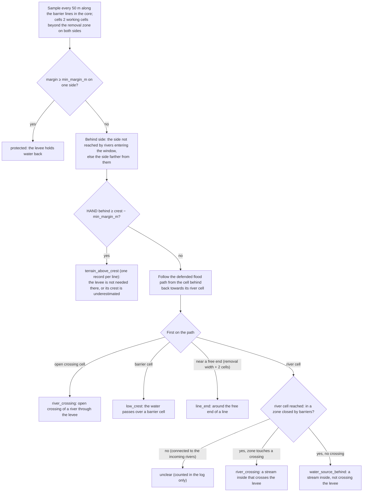

**Path back.** The flood path is recovered from the order of `priority_flood`: the
predecessor of a cell is its 4-neighbour taken first from the queue, the cell that reached
it (`gis.Hydro.first_event_on_path`, numba). The first event on the way back is where the
water gets behind the levee.

**Columns of `leaks.gpkg`:**
- `leak_id`, `cause`;
- `x`, `y`: the place (crossing cell, overtopped cell, free end, stream cell, or the first
  sample of the line for `terrain_above_crest`);
- `levee_length_m`, `n_samples`: the levee that leaks there;
- `line_ids`: the `line_id`s of `barriers.gpkg`;
- `crest_hand_median_m`, `level_behind_median_m`, `lost_margin_median_m`: the crest and the
  water level behind, above the river, and their difference, i.e. the protection the leak
  costs.

The log lists the causes with their levee length, and the five largest leaks.

**Values.** Sample spacing 50 m (`leaks.sample_spacing_m`, `Config.DEFAULTS`); the side
offset and tolerances come from the existing keys.

**Test** (Stage B, crossings open): rings 1 and 2 leak through the streams inside them
(`water_source_behind` at the stream cells, 1400 m of levee each, 2.5 m of protection
lost); ring 3 does not leak. Pipeline: the open gap of C_wide is found as free line ends.

### 5.11 Transport embankments from the DTM (`transport_embankments.py`)

Road and railway embankments in the floodplain can hold water back like levees. The
lines you list in `countries.<code>.transport_lines` (a file you prepare, e.g. roads and
railways) only show **where to look**. Their attributes are not used: every decision comes
from the DTM.

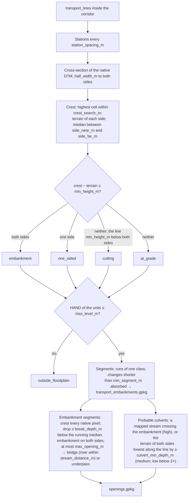

**Classes per station:**

| Class | Profile |
|---|---|
| `embankment` | crest at least `min_height_m` above the terrain on **both** sides; only these are barriers |
| `one_sided` | above the terrain on one side only (a road on a hillside bench) |
| `cutting` | the line lies `min_height_m` below the terrain on both sides |
| `at_grade` | none of these |
| `outside_floodplain` | HAND of the units above `protected_areas.max_level_m` |

**Openings** (`openings.gpkg`; `type`, `width_m`, `invert_z`, `crest_z`, `confidence`,
`evidence`):
- **Bridges and underpasses** are breaks in the crest. The crest is followed at every
  native pixel along embankment segments, so openings narrower than the station spacing
  are found too. The width is the length of the break and the invert the lowest DTM cell
  in it. Confidence is high, because the break is visible in the DTM.
- **Probable culverts** are not visible in the DTM. They are inferred where water must
  cross the embankment:
  - a mapped river line crosses it (high confidence);
  - the terrain of **both** sides is lowest along the line, i.e. a valley passes under a
    continuous crest (medium confidence when at least twice `culvert_min_depth_m` deep,
    low below that).

  Their width is unknown (NaN). The invert is the lower side terrain.

**Segments** (`transport_embankments.gpkg`): `class`, `length_m`, `crest_z_min`,
`crest_z_median`, `height_left_m`, `height_right_m`, `height_min_m` (lower side),
`footprint_m`, `hand_median_m`, `openings`, `line_id`, `source`.

**Plots** (`plots/transport/<RUN_ID>/index.html`):
- cross-sections of sample stations per class (`cross_sections_per_class`);
- crest profiles along embankments, the crest at every pixel, openings marked;
- a map of the classes and openings;
- a summary.

**Parameters** (`[transport]` in `config/advanced.toml`): the defaults in the diagram
were set on the synthetic tests. **Check them on your pilot units**: the cross-sections
show whether `side_near_m`/`side_far_m` reach beyond the footprint of your embankments,
and the crest profiles whether `break_depth_m` separates bridges from crest noise.

**Measured** (benchmark DTM at 1 m, 78 km of lines inside the corridor, 7 828 stations):
- 6–18 s in total (warm and cold disk cache);
- profiles 3.4–7.4 s, floodplain test 0.6–4.8 s;
- peak memory 1.2 GB.

The time grows with the length of the lines and with the DTM pixels per profile (91 at
1 m, 9 at 10 m).

**Not yet:** the embankments do not enter the barriers yet. Integration (lowest-priority
barrier class, culverts open or closed, protected areas relying on embankments marked,
comparison with and without) is the next step.

**Test** (`pixi run test-transport`, 15 checks, synthetic country T7):
- **classes:** an embankment, a cutting through a ridge, a road at grade, a road on a
  hillside bench;
- **openings:** a 30 m bridge over the river and an 8 m underpass, both with their exact
  width; a culvert in a valley under a continuous crest (medium); a culvert where a mapped
  stream crosses (high);
- **no other openings,** and the plots with `index.html`.

## 6. Large DTMs: corridors, storage layout, units

National DTMs of 150–600 GB are never loaded whole. All reads go through `gis.Raster`
window functions on processing units.

### 6.1 Footprint

`Raster.footprint` reads the DTM decimated to `footprint_resolution_m` in a single call:
- **with overviews**, GDAL serves the read from the closest overview;
- **without overviews**, it decodes only the strips or tiles that contain the sampled
  rows and columns.

The valid mask is dilated by one coarse cell (recall) and polygonized. On the benchmark
DTM in strip layout this took 0.1 s per file.

### 6.2 Corridor

Corridor = rivers buffered by `corridor_buffer_m`, intersected with the footprint.
Protected areas far from the modelled rivers cannot be flooded by them.

### 6.3 Storage layout and conversion

`prepare_dtm.py` reports for every DTM:
- size, pixel size, data type, nodata, compression, block size, overviews, file size;
- a **benchmark**:
  - 20 random 4096² native windows inside the footprint;
  - the same ground windows with `gdal.Warp` to the working resolution;
  - one sequential full-width read;
  - the compression ratio and speed of the target layout, measured on one window.

**Overview use is verified, not assumed.** An extra single-threaded warp with
`CPL_DEBUG` reports the source window the warp kernel reads, and a source window smaller
than the native one proves that an overview was used. A multithreaded warp cannot be
inspected this way, because its debug messages come from worker threads, whose error
handlers are separate per thread.

**Why layout matters.** In a strip layout (block height below 64, or block width equal
to the raster width) without overviews, every warp decodes every native pixel. Measured
per 30 M-cell unit (§13): terrain read **8–9 s** in strip layout, **1.7–2.3 s** after
conversion option A.

Conversion only runs with `convert_dtm = true`. Both options read the source once,
sequentially, and build `AVERAGE` overviews at factors 2–32 with the same compression and
predictor:
- **Option A:** the whole file as a tiled GeoTIFF (512², ZSTD or DEFLATE, predictor 3
  or 2, BigTIFF, all CPUs).
- **Option B:** only the corridor **plus the halo**, written in row blocks sized by
  `warp_memory_limit_mb`.

Before any conversion the script prints, from the measurements:
- **disk space:** raw size × measured compression ratio × 4/3 for overviews; for B, also
  × the domain share;
- **time:** sequential read time plus compression time.

It also checks the free disk space and stops if it is insufficient.

### 6.4 Units

- **Cores.** Square, `unit_core_size_m`, aligned to the working grid anchored at the DTM
  origin. Only cores that intersect the corridor are kept. Ids are `<column>_<row>`.
- **Windows.** Each core plus `unit_halo_m`, clipped to the DTM extent.
- **Domain.** Inside the window, cells outside the corridor plus halo are nodata and
  skipped by every algorithm.

**Halo rule: `unit_halo_m ≥ corridor_buffer_m`** (checked in the configuration).
1. A core cell can lie up to `corridor_buffer_m` from its river.
2. The window extends `unit_halo_m` beyond the core in every direction.
3. So the river point nearest to every core cell is inside the window only if
   halo ≥ buffer.
4. Without it, HAND has no valid reference; units whose window contains no river are
   listed.

**Memory model.** RAM per unit ≈ window cells × `bytes_per_cell`.
- **Check:** `build_units.py` stops if the largest window would exceed
  `max_ram_gb_per_worker` and prints the largest core size that fits.
- **Measured value:** `protected_areas.py` logs the measured bytes per window cell, now
  **93–95 B**.

## 7. Parallel processing, checkpoints, merging

### 7.1 Pool

`gis.Run.run_units` uses a `ProcessPoolExecutor` with the `spawn` start method and
`max_tasks_per_child = 1`:
- **A fresh process per unit.** Peak RSS is exact per unit, memory is returned to the
  system after each unit, and Linux and Windows behave the same.
- **Per-process GDAL handles.** Each worker opens its own GDAL datasets, because GDAL
  handles cannot be pickled, and sets `GDAL_CACHEMAX` and `GDAL_NUM_THREADS` from the
  configuration.
- **Compilation once.** The numba kernels are compiled once in the main process, so
  workers load them from the cache.
- **Submission order.** Units are submitted largest first; the ETA is based on the domain
  cells finished so far.
- **Failures.** A crashed worker, e.g. one killed for lack of memory, is reported; a rerun
  retries only units without a done marker.

### 7.2 Checkpoints

- **`protected_areas.py`:** each unit writes to `work_dir/<country>/units/<unit_id>/` and
  finishes with `done.json` (timings, peak RSS, counts), written atomically through a
  temporary file and a rename.
- **`rp_index.py`:** writes `rp_index.json` per unit and recomputes it when the unit's
  `done.json` is newer.
- **Reruns** skip finished units unless `FORCE = True`; `UNITS` restricts a run to the
  listed units.
- **Merging** always uses all finished units.

### 7.3 Merging

The same protected area can be found by several units, because windows overlap by twice the
halo.

1. **Grouping.** Candidates from different units that overlap by at least
   `merge_overlap_ratio` of the smaller one form a group (connected components).
2. **Groups with a complete candidate.** Keep the complete (not truncated) candidate
   whose representative point lies in its own unit's core; if several qualify, keep the
   one farthest from its window edge. A ring across a core boundary is kept exactly once.
3. **Groups truncated in every window** (protected areas longer than a window):
   - the pieces are **united** (recall);
   - level, entry and source come from the piece with the **lowest** protection level. A
     window edge can only overestimate protection, because it acts as a wall.
4. **Contradiction rule** (`drop_contradicted_truncated`):
   - **What it catches:** window edges can create artificial protection, for example an
     area behind a long levee that looks enclosed because the window edges close it.
   - **Rule:** a protected area truncated in every window is dropped when finished units
     whose windows cover at least `contradiction_ratio` of it found nothing there. Those
     units see more of the levee.
5. **Identifiers.** `protected_area_id = <country>_<x>_<y>`, from the representative point
   rounded to `id_rounding_m`, stable between runs. Duplicates get a suffix.

Barrier crest statistics in `barriers.gpkg` are sampled inside each unit's **core** only
and combined as the minimum.

## 8. River lines and water sources

### 8.1 Snapping the rivers into their channel (always)

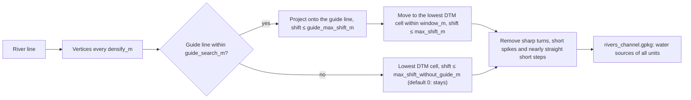

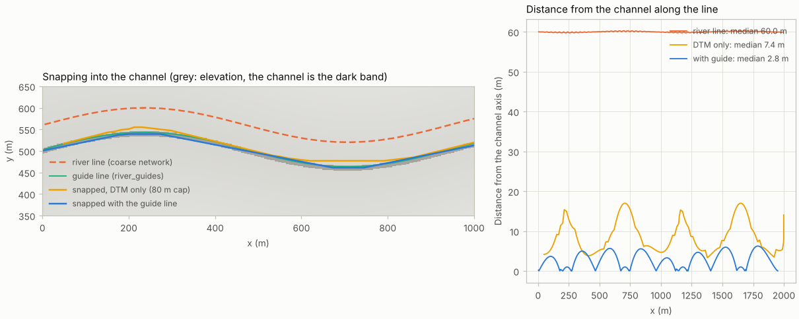


River networks such as MERIT come from coarse grids (about 90 m). Their lines run beside
the real channel, cross levees where the river does not, and put water sources on the
protected side. `protected_areas.py` therefore snaps the rivers once per country, before
the units, and writes **`rivers_channel.gpkg`**. All units use these lines: they are
rasterized as river cells and are the water sources.

**Method.** `gis.Hydro.snap_to_channel` follows your MERIT snapping procedure:
1. **Densify.** Vertices are densified to `densify_m`.
2. **Guide lines** (optional input `country.river_guides`, e.g. waterway lines you
   prepare): each vertex is projected onto the nearest guide line within
   `guide_search_m`. The shift is capped at `guide_max_shift_m`.
3. **DTM minimum.** Each vertex then moves to the lowest DTM cell within `window_m`.
   - **Cap with a guide:** `max_shift_m`.
   - **Cap without a guide:** `max_shift_without_guide_m`, default 0 as in your procedure.
     Without guide lines the rivers therefore stay where they are unless you raise it.
4. **Clean-up.** Interior vertices are removed:
   - **sharp turns:** below `min_angle_deg`, `angle_passes` passes;
   - **short spikes:** below `spike_angle_deg` on segments up to `spike_length_m`;
   - **nearly straight short steps:** above `straight_angle_deg`, on segments up to
     `straight_length_factor × spike_length_m`, `spike_passes` passes.

**Departures from the procedure:**
- **Chord check.** A nearly straight vertex is removed only within
  `straight_max_deviation_m` of the chord of its neighbours. Without this check,
  repeated passes collapsed a gently curved line to its two ends.
- **Unmoved parts stay unchanged.** Parts in which no vertex moved keep their original
  geometry.
- **No stop on missing guides.** Rivers without a guide line are not an error: the share
  of guided vertices is logged.

**Speed.** The DTM is read once, in bands of `band_rows` rows; the lowest cell of every
window is found with numpy for all vertices of a band at once. Vertices at the same place
move the same way, so connected lines stay connected.

**Rerun.** The file is reused until you run with `FORCE`, which snaps again and recomputes
all units.

**Test.** A sine channel in a 2 m DTM with the river 60 m beside it:
- with a guide line 3 m off, the snapped line lies a median of 2.8 m (at most 6.3 m) from
  the channel axis;
- without a guide it stays unchanged;
- DTM-only snapping with an 80 m cap brings it to a median of 7.4 m.

### 8.2 Water sources and closed streams

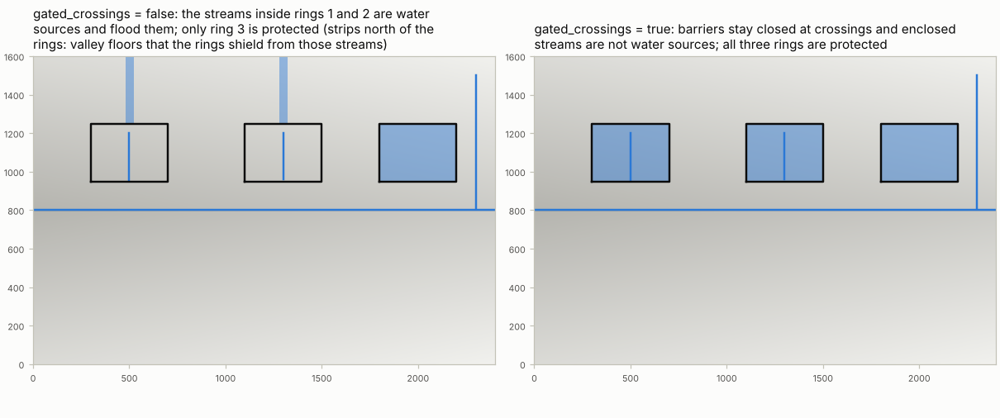


- **Water sources.** Every river line is a water source; the OSM steps of Stage B (closures
  from sluices and pumping stations, `rivers_sources.gpkg`) were removed in Stage G.
- **`gated_crossings = false`** (default): a river crossing a barrier opens it ("river
  wins").
- **`gated_crossings = true`:**
  - barriers stay closed at river crossings;
  - streams enclosed by barriers are neither water sources nor outlets of the HAND drainage,
    so HAND inside the enclosure refers to the outside rivers;
  - a stream that passes a closed levee keeps its outer part as a water source, because it
    is backwater of the river outside. Heights near it then refer to its bed. Rivers that
    end at the levee avoid this (test R1 of Stage B).

### 8.3 River groups and protected areas per group (file B)

**Why.** A flood does not come from all rivers at once. In file A every river is a water
source at the same time, so a small stream behind a levee can cut the protected area of
the large river in front of it. File B computes the protected areas per group of river
reaches: for each group, only its own rivers are water sources and the other rivers are
terrain.

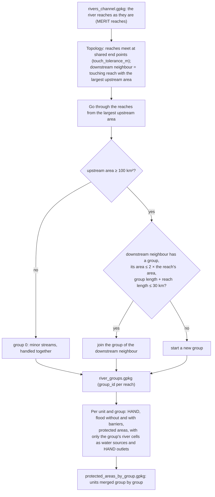

**Grouping** (`gis.Vector.river_groups`). The reaches stay as they are: a group is a set
of whole reaches, joined where the river does not change much.
- **Topology.** Reaches meet where their end points lie within `touch_tolerance_m`. The
  downstream neighbour of a reach is the touching reach with the largest upstream area,
  if it is larger than the reach's own.
- **Order.** Reaches are visited from the largest upstream area. A reach joins the group
  of its downstream neighbour when:
  - the upstream area grows at most 2× across the junction (a tributary much smaller
    than the main river starts its own group);
  - the group stays within 30 km. Any number of reaches can be joined.
- **Minor streams.** Reaches below 100 km² form group 0 and are handled together, as one
  more flood.
- **Values.** 2, 30 km and 100 km² are defaults in `gis.Config.DEFAULTS`
  (`river_groups.max_join_ratio`, `max_length_m`, `min_upstream_area_km2`), not in the
  toml files.
- **Needs** `river_upstream_area_field`. Without that column the groups and file B are
  skipped with a warning; file A is computed as before.

**Per group in a unit.** For every group with river cells in the window:
1. **HAND** on the undefended DTM with the group's river cells as the only outlets and
   burned cells.
2. **Floods.** Without and with the barrier crests, from the group's river cells.
3. **Protected areas.** The same rules and statistics as in file A (`min_margin_m`,
   `max_level_m`, `min_area_m2`).

`gated_crossings` (§8.2) applies as in file A.

**Merging.** The unit results are merged group by group with the same rules as file A
(§7.3). Areas of different groups may overlap: one place can be protected against the
large river and also against a stream.

**Outputs.**
- **`river_groups.gpkg`:** each reach with `group_id`, the upstream area and its length.
  The log gives the number of groups and the length per group (p5, p50, p95).
- **`protected_areas_by_group.gpkg`:** the columns of file A plus `group_id`.
- **Log:** the area of file B (overlaps counted per group) against file A.

**Cost and the crop.** Every group repeats HAND and the two floods. In the first POL run
they took 79 % of the time (10.7 µs per domain cell instead of 2.4).
- **Crop.** A group is therefore computed only in a crop around its river cells, extended
  by `river_groups.crop_margin_m` (default 5 km, `Config.DEFAULTS`). Areas touching the crop
  edge are flagged `truncated`, as at a window edge.
- **Trade-off**, measured on two benchmark units with 2 groups each:

  | Crop margin | Group time per unit | File B area |
  |---|---|---|
  | none (whole window) | 47–52 s | 2.02 km² |
  | 5 km (default) | 36–43 s | 1.84 km² |
  | 3.5 km | 29–36 s | 1.66 km² |
  | 2 km | 18–28 s | 1.66 km² |

  The loss is protection against a tributary near its confluence, more than the margin
  away from it. Windows of 26 km with many short tributaries (POL) gain more than the
  11 km benchmark windows.
- **Full computation.** A very large value, e.g. `[river_groups]` `crop_margin_m =
  100000.0` in `defenses.toml`, computes every group on the whole window again.

### 8.4 Later steps with file A or B (`LAYER`)

`rp_index.py`, `HAND_YZ.py`, `gfm_evidence.py`, `rp_bounds.py` and `validate.py` have the
run variable **`LAYER`**: `"A"` (default) or `"B"`.

**Files per layer:**

| | File A | File B |
|---|---|---|
| Protected areas | `protected_areas.gpkg` | `protected_areas_by_group.gpkg` |
| With return periods | `protected_areas_rp.gpkg` | `protected_areas_by_group_rp.gpkg` |
| Unit rasters | `labels.tif`, `hand_undef.tif` | `groups/labels_g<id>.tif`, `groups/hand_undef_g<id>.tif` |
| Other outputs | `exposure_lulc.csv`, `gfm_evidence.csv/.gpkg`, `event_rp(_combined).csv`, `discharge_matches.gpkg`, `validation*.…`, `plots/discharge/<RUN_ID>` | the same names with `_b`, `plots/discharge/<RUN_ID>_b` |

**Group rasters.** `protected_areas.py` writes the labels and the HAND of every river group
that protects something. They are cropped to its protected areas plus
`evidence.comparison_distance_m`, the reach of the GFM comparison zones. Each group is
valued and tested with its own HAND: the depth below the protection level and the
comparison zone refer to the group's river.

**Per group in the later steps:**
- **`rp_index.py`, `HAND_YZ.py`:** one task per unit and group, with checkpoints per
  group (`groups/rp_index_g<id>.json`, `groups/hand_yz_g<id>.json`).
- **`gfm_evidence.py`:** one task per unit and group. Missing-barrier hints come from
  file A only; `HINTS` is ignored for B.
- **`rp_bounds.py`:** the implied protected areas of Stage E belong to file A and are not
  added for B.
- **`validate.py`:** areas of different groups overlap. The area recall and precision use
  their union, so overlaps count once.

**Order for file B:** `protected-areas` → `rp-index` with `LAYER=B` (and `hand-yz` first
when land cover is enabled) → `gfm-evidence` and `rp-bounds` with `LAYER=B`. In the GUI,
**File** on the cards of these steps.

**Tests:**
- **Stage B:** `rp_index` values all group areas with their own rasters; rings 1 and 2
  in the town have value, ring 3 none.
- **Stage C:** GFM tests of the group areas (ring 1 of the main river held in scene E)
  and bounds in `event_rp_combined_b.csv`; file A unchanged.
- **HAND_YZ:** land cover value of every group area.

**Test** (Stage B country, crossings open):
- the main river is group 1, the three tributaries group 0;
- in file A only ring 3 is protected, because the tributaries inside rings 1 and 2 are
  water sources;
- in file B all three rings protect against the main river (group 1); against the
  tributaries (group 0) only ring 3 does.

## 9. Return period index

### 9.1 Exposure value (`rp_index.py`, per unit in parallel)

1. **GHSL building volume.** `download_ghsl.py` downloads the total and non-residential
   volume tiles (100 m, Mollweide) that intersect the DTM footprint, found with the
   tiling schema, and mosaics each product as a VRT.
   - `ghsl_epoch = 0` takes the latest epoch the server provides that is not after the
     current year; it is found by probing.
   - Epochs after the present minus five years are logged as modelled.
2. **Value per cell:**
   - residential volume = total − non-residential, clipped at 0;
   - floor area = volume / `storey_height_m`;
   - value = floor area × maximum damage per m² (`max_damage_csv`: columns `country`,
     `residential`, `non_residential`; one row whose `country` equals the country code).
3. **Totals-preserving warp.** The source average (volume per source cell) times the
   ratio of working to source cell area is the volume per working cell; Mollweide is
   equal-area.
   - **Totals check, every unit:** the warped total is compared with an independent total,
     the source cells weighted by the **exact** share of their area inside the window
     (reprojected window ∩ cell boxes).
   - **Measured:** within 0.03–0.05 %, which is about the scale distortion of the national
     grid. The configured tolerance is 1 %.
4. **Only the bounding box of the unit's kept protected areas** is valued: 2–5 s per unit
   instead of 15 s.
5. **Damage:**
   - depth per cell = max(0, `protection_level_m` − `hand_undef`);
   - damage fraction from `depth_damage_csv` (`depth_m`, `res`, `nonres`), interpolated
     linearly;
   - `value_exposed` V = Σ value × fraction over the protected area.

### 9.2 Score, classes, cap, interval (whole country)

1. **L**, `levee_length_m`: length of barrier lines within `levee_adjacent_distance_m` of
   the boundary. L = 0 sets `no_levee`; such protected areas get no score.
2. **A**, `upstream_area_km2`: from `river_upstream_area_field` of the river feature
   nearest to the source cell, or from `upstream_area_raster` at the source cell.
   Protected areas without A get a score from the value term only, and they are counted in
   the log.
3. **Score** = `w_v` × percentile rank of log(V/L) + `w_a` × percentile rank of log(A),
   ranked within the country. `v_rel` = V/L. V = 0 ranks lowest.
4. **Quantile mapping** (`gis.Stats.quantile_classes`): ascending scores get ascending
   `distribution_classes` with the configured shares; tied scores get the same class.
5. **Cap:**
   - **Rule.** `rp_cap` is a step function of `protection_level_m`: the first
     `cap_levels_m` value **above** the level selects the matching `cap_rp`. Above the
     last level there is no cap.
   - **Example.** With levels 0.5, 1, 2 and caps 10, 50, 100: a level of 0.3 m gives
     cap 10, a level of 1.4 m gives cap 100.
6. **RP:** `rp = min(rp_model, rp_cap, max_rp)`.
   - `rp_source = "cap"` when the cap or `max_rp` lowered the model value, or when there
     is no model value (`no_levee`); otherwise `"model"`.
   - A `no_levee` protected area without an applicable cap therefore gets `max_rp`, as the
     specification says ("from the cap only"). See the open decisions (§15.4).
7. **Interval:**
   - `rp_low` = the previous value in `classes` (the same value if `rp` is the lowest);
   - `rp_high` = the next value in `classes`, bounded by `rp_cap` and `max_rp`, never
     below `rp`.
8. **Overrides.** A protected area containing a point of the overrides file gets its `rp`,
   with `rp_low = rp_high = rp` and `rp_source = "override"`. If points disagree, the
   first is used and a warning is logged.
9. **Stage C columns.** `obs_rp_low`, `obs_rp_high`, `n_held`, `n_flooded`,
   `obs_conflict` and `model_obs_conflict` are present and empty; `rp_bounds.py` fills
   them (§11). `value_exposed` is an added column.

### 9.3 Land cover exposure (`HAND_YZ.py`)

GHSL measures buildings. Assets outside buildings carry no value in §9.1:
- crops;
- roads, railways and port areas;
- open-air equipment of industrial sites.

`HAND_YZ.py` adds them from land use and land cover data. The resulting value is added to
the building value: it **supplements** GHSL and never replaces it.

1. **Data.**
   - **ESA WorldCover 10 m** (2021, v200) everywhere. `download_worldcover.py` downloads
     the tiles of the official 3° tile grid that touch the corridor and builds
     `worldcover.vrt`. Local tiles can be listed in `lulc.worldcover` instead.
   - **Urban Atlas** where you provide it (manual download). It takes precedence wherever
     its polygons lie, also with classes that carry no value, because it is finer and
     distinguishes land use.
   - **Multi-layer files.** The configured layer (`urban_atlas_layer`) of a multi-layer
     file is copied to its own GeoPackage with `gdal.VectorTranslate`.
2. **Categories.** `worldcover_categories` and `urban_atlas_categories` map class codes
   to exposure categories such as `agriculture`, `built_up` and `transport`. Each category
   has two inputs:
   - a value per m² of land (`lulc.max_damage_csv`, columns `country` + categories);
   - a depth-damage curve (`lulc.depth_damage_csv`, `depth_m` + categories).
3. **Damage.** Depth per cell is `max(0, protection_level_m − hand_undef)`, as in §9.1.
   Value = cell area × value per m² of the cell's category; damage = value × the
   category's damage fraction at that depth. Sums per protected area and per category go to
   `exposure_lulc.csv`: `value_lulc`, `lulc_exposed_area_m2`, `lulc_<category>`.
4. **Grid.** WorldCover classes are read with nearest neighbour onto the working grid.
   Its pixels (about 6–9 m in Europe) are as large as or larger than the working cells
   (2–5 m). Urban Atlas polygons are rasterized by cell centre.
5. **Combination in `rp_index.py`.** With `lulc.enabled = true`:
   `value_exposed = value_ghsl + value_lulc`. The score then uses this sum, and both
   parts stay in `protected_areas_rp.gpkg`.
6. **No double counting.** The values per m² must cover only what GHSL does not hold.
   - **WorldCover `built_up` class:** it contains buildings, so its value should cover
     roads, utilities and open-air assets only.
   - **Unknown values:** set the value to 0 if unsure.
7. **Checkpoints.** Each unit stores a hash of its inputs in `hand_yz.json`: values,
   curves, mappings, file dates of the WorldCover tiles and Urban Atlas files. A rerun
   recomputes exactly the units whose inputs changed (tested).

**Verified and unverified sources.**
- **WorldCover, verified:**
  - URL pattern and tile grid from the official ESA-WorldCover download script;
  - a request to a real tile (HTTP 200);
  - class codes and licence (CC BY 4.0) from the tile's own metadata: 10 tree cover,
    20 shrubland, 30 grassland, 40 cropland, 50 built-up, 60 bare/sparse vegetation,
    70 snow and ice, 80 permanent water, 90 herbaceous wetland, 95 mangroves, 100 moss
    and lichen.
- **Urban Atlas, not verified:** the class field and code list could not be checked,
  because the EEA hosts were blocked in this session. A catalogue search shows the field
  `code_2018` and codes such as 11100 (continuous urban fabric), 12100 (industrial,
  commercial, public, military and private units) and 12210 (fast transit roads). The
  configuration entries are therefore empty.

## 10. Observational evidence: Copernicus GFM

The model RP of §9 is an *a priori* estimate built from exposure and topography. Stage C
adds what was actually observed: whether a protected area stayed dry while its surroundings
were flooded (Global Flood Monitoring, GFM, Sentinel-1 SAR flood extents since 2015), and
how rare the discharge was on that day (GloFAS and EFAS, §11). Observations bound the RP; they never
create, move or delete a protected area.

### 10.0 GFM access, layers and the maximum flood extent

Verified on the service on 2026-11-13; details in `docs/stage_h_gfm_access.md`.

**Access (no account needed).**
- **Search:** STAC API `https://stac.eodc.eu/api/v1`, collection `GFM`, scenes since 2015,
  all processed with one version (v3.1.0).
- **Files:** cloud-optimised GeoTIFFs on `https://data.eodc.eu`, read directly by GDAL;
  20 m pixels on Equi7 tiles of 300 km.
- **CRS:** the Equi7 grid of the continent (azimuthal equidistant), given as WKT **without
  an EPSG code**. The package reads the CRS from every file and assumes none.
- **Licence:** CEMS terms of service, free and open. Publications need the notice
  "Generated using Copernicus Emergency Management Service information [Year]", or
  "Contains modified …" for adapted data.

**Layers used** (observations only; `[sources] gfm_assets`):

| Role | Asset | Values |
|---|---|---|
| flood | `ensemble_flood_extent` | 1 flood, 0 none, 255 no data |
| exclusion | `exclusion_mask` | 1 = no reliable observation (forest, built-up, topography, radar shadow) |
| reference water | `reference_water_mask` | 1, 2 = permanent and seasonal water (monthly mask) |
| likelihood (optional) | `ensemble_likelihood` | 0–100; flood pixels 50–100 |
| advisory (optional) | `advisory_flags` | 1 low regional backscatter (frost, snow, dry soil), 2 rough water (wind), 3 both |

- **Excluded share.** In the scene checked for southern Poland, 66 % of the observed pixels
  were excluded. Valid observations inside protected areas are scarcer than the swath
  suggests.
- **Never used:** terrain-extended extents or depths, GFM "Affected population" and
  "Affected land cover".

**Switch `[evidence] use_advisory_flags`** (default `false`). With `true`, cells with an
advisory flag are not valid observations, neither wet nor dry: under frost, dry soil or
wind the contrast between water and land is unreliable. It needs the advisory layer of
the scenes: `download_gfm.py` copies it from now on; scenes downloaded earlier are tested
without it (the log gives the count).

**Maximum flood extent: how to get the official product.** It is generated on demand for
a registered user and is not part of the STAC archive, so the package cannot fetch it. It
is only needed for the comparison with the event composite (Stage H). Step by step:

1. **Register.** Open `https://portal.gfm.eodc.eu`. With a GloFAS or EFAS account, log in;
   otherwise choose **Register**, fill in the form and confirm the e-mail.
2. **Create the area of interest.** Choose **AOI** in the main banner, enter a name and a
   description, **Next Step**. Then one of:
   - **AOI Coordinates:** enter the upper-left and lower-right latitude and longitude;
   - **Draw AOI:** draw a rectangle on the map;
   - **Regions:** pick a country and an administrative region.

   **Save AOI.** At most 25 AOIs per user. For the pilot event (September 2024, southern
   Poland) the search of step 1 used 16.0–18.5° E, 50.0–51.2° N.
3. **Load the products.** Choose **Products** in the main banner, select the AOI under
   **Select AOI**, set the **Start** and **End** date (do not tick "Latest"), **Load
   products**.
   - The period can be **at most two months**. For a longer event window, order two
     periods.
4. **Order.** Choose **Download maximum flood extent**. In the window, tick the format
   **raster (tiff)** and check the AOI and the dates, then **Generate extent**.
5. **Wait for two e-mails:** a confirmation, then the link to the file when it is ready.
   Download it.
6. **Give it to the package:** put the GeoTIFF anywhere and list its path in
   `defenses.toml`:

   ```toml
   [evidence]
   max_extent_files = ["D:/data/gfm/max_extent_2024-09_PL.tif"]
   ```

   Several files (periods, areas) can be listed. Their CRS is read from the files.

The same order is possible through the REST API `https://api.gfm.eodc.eu/v2`
(`/auth/get_bearer_token`, then `/download/max_flood_extent/{aoi_id}/{start}/{end}` and
`/download/max_flood_extent/{order_id}`); it needs the same account.

### 10.1 Scene search and screening (`download_gfm.py`)

1. **One search for all units.** The densified unit cores are transformed to WGS84. Their
   common box goes to the STAC item search `GET {gfm_stac_url}/search` with `collections`,
   `bbox`, `datetime` (`gfm_date_from` to `gfm_date_to`; today when empty) and
   `limit = gfm_page_limit`.
   - The script follows `rel="next"` links to the last page.
   - A link that declares `method: POST` is sent as POST with its JSON `body`, because STAC
     APIs page either way.
   - Requests go through `gis.Http.get_json` (urllib, retries, exponential backoff); no STAC
     client library is needed.
2. **Token.** If `gfm_token_env` names an environment variable, its value is sent as
   `Authorization: Bearer …` with the search and with GDAL's HTTP reads
   (`GDAL_HTTP_HEADERS`). The token never appears in the configuration or the logs.
3. **Scenes to units.** Each item is assigned to the units whose core its footprint
   (`geometry`, else `bbox`) touches.
4. **Screening: one read per scene, at `gfm_screen_resolution_m` (100 m).** The flood layer
   is read once through `/vsicurl/`, with `average` resampling, over the union of the
   windows of all units the scene covers.
   - **Shared grid.** All unit windows are snapped to one grid of screening cells, so each
     unit's part is a plain slice of the scene's array.
   - **Cost.** A cloud-optimised GeoTIFF serves the read from its overviews: kilobytes
     instead of the 20 m data.
   - **Flooded share.** The mean of the 0/1 layer per screening cell is the flooded share;
     cells with a `gfm_nodata_values` code are left out of the mean.
   - **Flooded area.** The shares are summed over each unit's domain and converted to
     working cells.
   - **Skip rule.** A unit window with at most `min_valid_pixels` flooded working cells
     cannot produce a valid test, so it is skipped. Most acquisitions over a river are dry,
     so only the few scenes that matter get copied.
   - **Why one read per scene, not per unit and scene.** A country has hundreds of units
     and each unit about a thousand Sentinel-1 acquisitions since 2015. Reading per unit
     would mean hundreds of thousands of latency-bound requests; reading per scene cuts that
     by the number of units a scene covers.
5. **Clipped copies.** For each kept pair of scene and unit, the flood, exclusion and
   reference water layers are cut to the unit window with
   `gdal.Translate(projWin, projWinSRS)`. The optional likelihood layer is cut too when the
   item has it.
   - **Format.** Tiled, compressed GeoTIFFs in `work/<c>/gfm/<unit>/`.
   - **Grid.** The copies stay in the GFM grid and CRS. Reprojection happens once, in
     `gfm_evidence.py`, directly onto the unit grid; resampling twice would shift the 20 m
     pixel edges.
6. **Threads.** `gfm_download_threads` scenes are screened and copied at the same time.
   The work waits on the network, and GDAL releases the GIL while it waits, so threads are
   enough; no processes are needed.
7. **Checkpoint and incremental updates.**
   - Every screened pair of scene and unit, kept or not, is appended to
     `work/<c>/gfm/screening.csv`.
   - A rerun screens only new pairs, so running the script again a year later fetches only
     the new acquisitions. `FORCE` screens the selected units again.
   - A scene that cannot be read is logged and retried in the next run.
8. **Index.** `gfm_index.csv` lists the kept pairs: `unit_id`, `item_id`, `datetime`,
   `flooded_pixels` and the layer paths.

### 10.2 Tests per protected area and scene (`gfm_evidence.py`)

A dry protected area on a dry day proves nothing. Each scene therefore answers a comparative
question: **was the protected area dry while the undefended floodplain at the same height next
to it was wet?** Only that comparison, made within the same scene, turns a dry protected area
into evidence.

1. **Reading.** The three layers are warped with nearest neighbour onto the unit's working
   grid, which is the exact grid of `labels.tif` and `hand_undef.tif`.
   - **Valid cell:** it has data (`gfm_nodata_values` count as nodata even if the file
     declares none), is not excluded, is not reference (permanent) water, and has a HAND
     value.
   - **Wet cell:** valid and carrying one of the `gfm_flood_values`.
2. **Inside:** the valid cells of the protected area (its `unit_label` in `labels.tif`), giving
   `inside_valid_px` and `inside_wet_frac`.
3. **Comparison zone,** giving `comp_valid_px` and `comp_wet_frac`. It holds valid cells that
   meet all of these:
   - outside all protected areas;
   - within `comparison_distance_m` (chamfer distance from the protected area);
   - `hand_undef` at most the median `hand_undef` inside the protected area;
   - `hand_undef` at most `max_level_m`.

   **Why the HAND condition.** It restricts the comparison to terrain that an undefended
   flood up to the protected area's median level would also reach. If those cells are wet,
   water stood at least that high next to the levee.
4. **Outcome:**
   - `no_test` unless both pixel counts reach `min_valid_pixels` and
     `comp_wet_frac ≥ f_wet_comparison`;
   - `held` if `inside_wet_frac ≤ f_dry_inside`;
   - `flooded` if `inside_wet_frac ≥ f_wet_inside`;
   - otherwise `inconclusive`.
5. **Efficiency.**
   - **Read extent.** Without hints, each scene is read only over the bounding box of the
     unit's kept protected areas plus the comparison distance.
   - **Zones.** Each protected area's zone is computed once, in its own bounding box, and
     reused for every scene.
   - **Parallelism.** Units run in parallel with the same pool as `protected_areas.py`.
6. **Outputs:**
   - **`gfm_evidence.csv`:** one row per protected area and scene.
   - **`gfm_evidence.gpkg`:** the same rows with the protected area polygon, for QGIS. Filter
     by `item_id` or `datetime` and symbolise by `outcome`.
7. **Checking a named flood event.** Restrict the run to the event's dates:

   ```python
   DATE_FROM = "2024-09-12"   # first and last day of the event
   DATE_TO = "2024-09-25"
   ```

   The result is the event's evidence table plus a GeoPackage for visual inspection.
   Without the filter, all scenes in the index are tested.
8. **Consistency.**
   - The unit rasters must come from the same `protected_areas.py` run as `protected_areas.gpkg`,
     because `unit_label` points into them. After rerunning `protected_areas.py`, rerun this
     script.
   - Thresholds `f_*` are placeholders. With 0.05 and 0.3, "dry" tolerates 5 % wet cells
     (SAR noise, local ponding), and "flooded" requires 30 % of the valid area to be wet.

### 10.3 Missing-barrier hints (`HINTS = True`)

1. **Scene water level in HAND.** It is the `river_level_percentile` (90 %) of `hand_undef`
   among wet valid cells **connected to the river**.
   - **Connectivity** runs through wet cells, reference water and the rasterized river
     lines.
   - **Why reference water counts.** The river is permanent water and never "wet" in the
     flood layer. Labelling wet cells alone would cut the flood off from its own river.
2. **Tested cells.** A cell is tested if it meets all of these:
   - valid and outside protected areas;
   - at least `hint_exclusion_m` from barrier lines and protected areas;
   - `hand_undef < level − hint_margin_m`.

   Each scene adds to the cell's `test_count`, and also to its `dry_count` where the cell
   stays dry.
3. **Hints.**
   - **Selection:** cells with `test_count ≥ hint_min_scenes` and
     `dry_count / test_count ≥ hint_dry_share`.
   - **Clusters:** the selected cells are clustered, clusters of at least `min_area_m2`
     are kept, and they are polygonised into `missing_barrier_hints.gpkg` with `area_m2`,
     `scenes_tested_mean` and `dry_share_mean`.
   - **Units:** as with protected areas, each hint is taken from the unit whose core holds its
     representative point.
4. **`hint_exclusion_m` (an addition to the specification).** A levee that holds is itself
   dry, and so are its toes and the 20 m GFM pixels that mix the levee with the floodplain.
   - **The problem.** These cells lie below the water level in `hand_undef`, because the
     levee was removed from that surface. Without the exclusion, every levee that held
     would show up as a "missing barrier" along its own body.
   - **The test shows it.** Without the exclusion, the levee bands of two rings become
     hints (3 areas instead of 1).
   - **Default.** 40 m = two GFM pixels.
5. **Limitation: HAND is relative to the drainage cell.**
   - **Backwater.** When a large river backs up into a tributary valley, cells along the
     tributary have low HAND relative to the tributary, while the main river sets the
     flood level. Such cells can stay dry legitimately and still appear as hints.
   - **Consequence.** Hints are candidates for inspection, not results, and they change no
     protected area.
   - **Better level, not implemented.** A level per drainage target would need the
     `breach_to_streams` target index stored per unit, which `protected_areas.py` does not keep.

### 10.4 Flood events (Stage H, in progress)

Stage H adds an event level to the scene-by-scene evidence of §10.2: flood events are
defined from discharge, the GFM scenes of an event are combined, and a protected area gets
one outcome per event. Steps: access check (done, §10.0), event catalogue and event
composites (done, below), event evidence, integration into `rp_bounds.py`.

**Event catalogue (`flood_events.py`, `pixi run flood-events`).** Needs `river_groups.gpkg`
(§8.3) and the prepared discharge (§11.3).

1. **Discharge cell per river group.** The largest reach of a group (by upstream area) is
   matched at its mid point to a discharge cell, with the rules of §11.5 (search radius,
   upstream area ratio, same river). The sources are tried in the order of
   `discharge.sources`; the first with a match is the source of the group.
2. **Peaks.** Every run of days with a return period of at least `events.min_peak_rp`
   (Gumbel fit of the cell, §11.4) gives one peak, the day of its highest discharge.
3. **Window.** From `events.days_before` before the peak to `events.days_after` after it.
   The long tail is deliberate: water behind an overtopped levee stays visible after the
   peak.
4. **Merging.** Peaks whose windows overlap form one event with the highest peak;
   `n_peaks` counts them.

**Not covered.**
- **Group 0** (minor reaches below 100 km²) has no single river and gets no events.
- **Groups without a discharge cell** get none either; `event_groups.csv` lists the match
  of every group.

**Outputs.**
- **`events.gpkg`**, one feature per event with the lines of its group: `event_id`
  (`<country>_E<group>_<peak date>`), `group_id`, `source`, `cell_id`, `peak_date`,
  `peak_discharge`, `peak_rp` (capped at `discharge.max_rp_extrapolation`, then
  `extrapolated`), `window_start`, `window_end`, `n_peaks`, `match_quality`,
  `upstream_area_km2`.
- **`event_groups.csv`:** group, source, cell and number of events.
- **Plots** in `plots/events/<RUN_ID>/index.html`: hydrographs of the groups with the
  largest peaks (windows shaded, the threshold dashed) and events per year.

**Parameters** (`[events]`, placeholders): `min_peak_rp = 2.0`, `days_before = 5`,
`days_after = 21`, `max_dry_scenes = 3`. At RP 2 a river has about one event in two years, so a country has
thousands of events; only those since the first GFM scenes (2015) can get evidence.

**Measured.** 3 400 groups and cells with 44 years of daily values: 15 s in total
(matching 12.7 s), peak memory 1.5 GB, of which the series take 0.2 GB per 1 000 cells.

**Test of the catalogue** (`pixi run test-stage-h`): one peak with its window and Gumbel RP; two
peaks 18 days apart merged into one event; two events years apart; a series without a
flood (about one event in five years at RP 5); the source order; a group without a
matching cell; ids and geometry; plots.

**Dry scenes for events (`download_gfm.py`).** Scene windows are kept only when they show
flood in the unit. "Held" needs dry observations after the peak, so, when `events.gpkg`
exists, a second pass copies a few dry windows, and only where they can decide an outcome:
- **Units:** only units with protected areas (file A or B) that the buffered lines of the
  event's river group cross (`corridor_buffer_m`).
- **Events:** only where the event has a wet scene in that unit: without water outside,
  no levee is tested.
- **Scenes:** the first `events.max_dry_scenes` (3) acquisition days with a dry scene
  **after the peak**.
- **Bookkeeping:** the windows are marked `event_dry` in `screening.csv` and
  `gfm_index.csv`. The scene-level tests of `gfm_evidence.py` ignore them, so their results
  do not change. A rerun copies only what is missing.
- Run order: `flood-events`, then `download-gfm` (again).

**Event composites (`event_composites.py`, `pixi run event-composites`).**
1. **Scenes of an event:** for every unit the buffered lines of the group cross, the
   scene windows of `gfm_index.csv` inside the event window.
2. **Common grid:** every scene is brought to the unit grid (the grid of `hand_undef.tif`)
   by nearest neighbour; the CRS of the scene is read from its file. Valid = observed, not
   excluded, not reference water (and without an advisory flag when the switch is on).
3. **Per cell:** `max_extent` (1 wet at least once, 0 observed dry, 255 never valid),
   `n_valid`, `n_wet`, `first_wet` and `last_wet` (days from the window start, −1 never).
4. **Per-scene masks** are not stored again: they are the clipped scene layers.

- **Outputs:** rasters `work/<c>/events/<event_id>/<unit>_<layer>.tif`;
  `event_composites.csv` per event and unit (scenes, acquisition days, first and last day
  relative to the peak, days after the peak, wet and observed area); maps in
  `plots/events/<RUN_ID>/composite_maps` (maximum extent, first wet day, valid
  observations, protected areas).
- **Run variables:** `EVENTS` and `UNITS` select the pilot; `FORCE` recomputes.
- **Official maximum flood extent** (`evidence.max_extent_files`, §10.0): every file is
  compared with the composites it overlaps, on their grid: area in both, only in the
  composite, only in the official product, and how much of the latter lies on cells the
  composite never saw valid (`max_extent_comparison.csv`, the log gives the IoU per event).
  The period of the file is not known to the package: compare it with the event you
  ordered it for.
- **Measured:** 20 scenes on a 2600 x 2600 cell unit (10 m) take 9 s (0.45 s per scene),
  peak memory 0.6 GB, 7.6 MB of rasters.

**Test** (Stage H, 16 checks; Stage C, 28): the dry scene selection; a composite from
scenes in another CRS with an excluded strip and reference water; counts, first and last
wet day; a scene outside the window ignored; the comparison with an "official" extent;
the second download pass on the mock GFM server.

## 11. Observed bounds of the return period: GloFAS and EFAS (Stage F)

Stage F replaces the GloFAS part of Stage C:
- **Removed and replaced.** `download_glofas.py` is gone. The old keys are migrated (§3).
- **Two discharge sources.** GloFAS and EFAS both turn the outcome of a GFM test into a
  return period. Discharge never delineates a protected area and is never used as a hazard.
- **Chain:**
  1. `download_discharge.py` downloads the raw files;
  2. `discharge_prepare.py` builds the daily series and the Gumbel fits;
  3. `rp_bounds.py` does the matching, the event return periods, the combination of the
     sources and the bounds.

### 11.1 Sources, access and licences

| | GloFAS | EFAS |
|---|---|---|
| EWDS dataset | `cems-glofas-historical` (verified) | `efas-historical` (verified) |
| Discharge variable | `river_discharge_in_the_last_24_hours` (verified) | from the EWDS form (not set) |
| Request values | `system_version = version_4_0`, `hydrological_model = lisflood`, `product_type = consolidated` (verified); the rest from the form | from the form |
| Grid and step | 0.05°, 24 h | v5.0: 1 arcmin, 6 h (verified) |
| Upstream area | `glofas_upArea.nc`, m² (verified) | source and units to verify |
| Requests | one per year (365 or 366 layers) | one per month (at most 124 layers) |

- **API.** `https://ewds.climate.copernicus.eu/api` (verified), used through `cdsapi`
  (approved; in `pixi.toml`).
  - **Credentials.** The personal key goes into `~/.cdsapirc` or the `CDSAPI_KEY`
    environment variable, never into the repository.
  - **Account and terms.** The EWDS needs an ECMWF account, and the terms of each dataset
    are accepted on its download form. Credentials of the legacy CDS do not work there
    ([EWDS page of the CEMS wiki](https://confluence.ecmwf.int/spaces/CEMS/pages/242067419/EWDS)).
- **EFAS access.** The dataset page states that the latest part of the record runs to near
  real time with a delay of about 6 days, and that this real-time part is reserved for
  EFAS partners
  ([efas-historical](https://ewds.climate.copernicus.eu/datasets/efas-historical)).
  - **To verify (F1).** Whether your account receives the whole period you need, and the
    first year.
  - **If EFAS fails,** the workflow continues with GloFAS only: `rp_bounds.py` uses the
    sources that `discharge_prepare.py` prepared and logs the missing one.
- **Licence.** Both datasets fall under the
  [CEMS-FLOODS datasets licence (rev. 1)](https://ewds.climate.copernicus.eu/licences/cems-floods).
  - **Use.** Free access for the listed purposes; the data are for information only; no
    intellectual property passes to the user. Use of Copernicus information is regulated
    by Regulation (EU) No 377/2014 and Delegated Regulation (EU) No 1159/2013.
  - **Attribution.** "Generated using Copernicus Emergency Management Service information
    [year]", or "Contains modified Copernicus Emergency Management Service information
    [year]" for modified data. The event return periods and bounds of this package are
    modified information, so the second notice applies.
  - **Citation of GloFAS.** Harrigan et al. (2020, ESSD) cite the dataset as
    [10.24381/cds.a4fdd6b9](https://doi.org/10.24381/cds.a4fdd6b9). Check the citation that
    the dataset page gives for version 4.0.
- **Status of these statements.** They come from search results. The EWDS, ECMWF wiki and
  EFAS hosts cannot be reached from this session, so confirm the wording on the licence
  page before publishing outputs.

### 11.2 Download (`download_discharge.py`)

1. **Area.** The box of `dtm_footprint.gpkg` in EPSG:4326, extended by `bbox_buffer_deg`.
   It is sent as north, west, south, east (4 decimals) under the area key of the form
   (`area_key`).
2. **Requests.**
   - **Base.** The request of the form (`request`), plus `data_format` and, if set,
     `download_format`.
   - **Time.** The year, the month(s) and the days 01–31 under the time keys of the form
     (`time_keys`). The service is expected to skip non-existent dates; the layer check of
     step 4 detects it if not.
   - **Split.** By `request_unit` (year or month), so that no request exceeds 500 layers
     (days × 24 / `step_hours`). A larger request stops the script before any download.
   - **GloFAS** accepts only `product_type = consolidated`: no mixing with intermediate
     data.
3. **Parallel and retries.** At most `max_parallel_requests` requests run at a time. A
   request is tried 4 times, with waits of 30, 60 and 120 s in between.
4. **Resume and integrity.** A file counts as complete only when:
   - GDAL opens it (for NetCDF, its `netcdf_variable`);
   - it holds the number of time steps the request asked for.

   Complete files are skipped. Anything else is downloaded again, through a `.part` file
   that is renamed only after the check. A zip archive (`download_format`) is unpacked.
5. **Local mode.** With `ewds_api_url = "file:///folder"` (on Windows
   `file:///C:/folder`), the files are copied from
   `<folder>/<source>/<year>[_<month>].<ext>`. This serves files downloaded by hand, and
   the tests.
6. **Outputs in `raw_dir`** (default `<work_dir>/<country>/discharge/raw`):
   - `<source>/<year>.<ext>` or `<source>/<year>_<month>.<ext>`;
   - `<source>/upstream_area.<ext>`: the static file copied from `upstream_area_file`;
   - `discharge_sources.json`: origin of each upstream area file;
   - `download_log.csv`, appended per run: source, file, request, status, size, seconds,
     attempts, error.

**Volume and time (estimate; the test requests of F1 are still due).** Uncompressed
float32, for a country box of 7° × 3°:

| Source | Cells in the box | Per request | Requests | Raw volume |
|---|---|---|---|---|
| GloFAS | 140 × 60 = 8400 | one year: 12 MB | one per year (46 for 1979–2024) | about 0.6 GB |
| EFAS | 420 × 180 = 75 600 | one month: 37 MB | one per month (240 for 20 years) | about 9 GB for 20 years |

- **Format.** GRIB packing roughly halves these numbers.
- **Time.** The EWDS queue, not the transfer, sets the pace. A forum report states that one
  month of 6-hourly EFAS data can take up to a day
  ([ECMWF forum](https://forum.ecmwf.int/t/efas-data-download-taking-a-long-time/13107)).
- **Consequence.** With `max_parallel_requests = 2`, the EFAS record may take days.
- **Alternative.** The dataset page also lists a 24-hourly EFAS discharge. It would mean one
  request per year and a quarter of the volume, at the cost of `daily_max` (decision in
  §15.4).

### 11.3 Daily series (`discharge_prepare.py`)

1. **River cells.** Cells of the upstream area file inside the box with at least
   `min_upstream_area_km2` (after `upstream_area_to_km2`).
   - **Identifier.** `cell_id` = row × columns + column on the grid of that file.
   - **Memory.** The series need days × cells × 4 bytes per source. With the template value
     of 50 km² (your choice), EFAS keeps roughly a quarter of the land cells (estimate;
     about 0.8 GB for a country and 30 years). With 0 km², every land cell of the box is kept (about 3 GB).
2. **Reading.** GDAL only, one window per band.
   - **GRIB:** the band's `GRIB_VALID_TIME`.
   - **NetCDF:** a `valid_time` dimension, otherwise the only time dimension. A `step`
     dimension or several time dimensions leave the valid time open, so the script stops
     instead of guessing.
3. **Time convention** (`valid_time_marks` per source).
   - **`end`:** the valid time closes the averaging period, so a value belongs to the day of
     (valid time − 1 s): a 24 h value stamped 00 UTC belongs to the day before.
   - **`start`:** a value belongs to the day of its valid time.
   - **Documentation.** ECMWF states that discharge "is stored as average over the time step
     of the model (6-hourly or 24-hourly), with time stamp (date and time of end of
     averaging period)" ([CEMS wiki](https://confluence.ecmwf.int/x/egRtD)). The template
     therefore uses `end`.
   - **Caveat.** MARS stores each 6-hourly step at its start: the 12:00 value covers
     12:00–18:00. The pre-release EFAS v5.0 historical archive was shifted by 6 h and has
     since been re-archived
     ([EFAS known issues](https://confluence.ecmwf.int/display/CEMS/EFAS+-+Known+Issues)).
     Which time a downloaded NetCDF file carries depends on the converter, so the setting
     is a placeholder until F1.
   - **Check on real files:**
     - the log line "valid times … to … UTC → days … to …" of each source;
     - the peak day of a known flood against the gauge record (the event you will name,
       F.7).
4. **Days that span two files.** Steps are aggregated file by file. The steps of the last
   day of a file wait for the next file, because with end-marks the 00 UTC step closes the
   previous day. This matters for monthly EFAS files when the time keys of the form are
   valid times (tested).
5. **Aggregation.**
   - **EFAS:** `aggregation` = `daily_mean` or `daily_max` of the four steps. A day needs
     all of them; otherwise it is NaN.
   - **GloFAS** is already daily: `daily_max` falls back to `daily_mean`, with a log line.
   - **Consistency.** Annual maxima and event discharges come from the same daily series, so
     both always use the same aggregation.
6. **Outputs:**
   - **`discharge_<source>.npz`:** `cell_id`, `lon`, `lat`, `upstream_area_km2`, `dates`
     (days since 1970), `values` (days × cells, float32), `years`, `maxima`;
   - **`discharge_cells_<source>.gpkg`** (EPSG:4326): `cell_id`, `upstream_area_km2`,
     `n_years`, `gumbel_xi`, `gumbel_alpha`, `fit_rmse`, `lon`, `lat`;
   - **plots** `plots/discharge/prepare/fit_<source>/`;
   - **`discharge_prepare_performance.json`.**

### 11.4 Frequency analysis

1. **Annual maxima per hydrological year.** A year starts on the first day of
   `hydrological_year_start_month` and is labelled by the calendar year it starts in.
   - **Complete years only.** Every day must be present, and for a cell every value must be
     finite.
   - **Minimum record.** Cells with fewer than `min_years` complete years are dropped from
     the outputs.
2. **Gumbel by L-moments:**
   - b0 = mean, b1 = Σ (i−1)/(n−1) · x(i) / n over the ascending sample, l1 = b0,
     l2 = 2 b1 − b0;
   - α = l2 / ln 2, ξ = l1 − 0.5772 α;
   - RP(Q) = 1 / (1 − exp(−exp(−(Q − ξ)/α))), and Q(RP) = ξ − α ln(−ln(1 − 1/RP)).
3. **`fit_rmse`.** RMSE between the sorted maxima and the fitted quantiles at Gringorten
   positions (i − 0.44)/(n + 0.12), in m³/s.

**Why Gumbel with L-moments.** It is stable for 20–45 annual maxima and has no shape
parameter to over-fit.

**Known weakness: heavy-tailed rivers.** The Gumbel tail is lighter than theirs, so a large
discharge receives a higher RP than it really has.
- **Held tests** then give lower bounds that are too high, the unsafe direction for a lower
  bound.
- **Flooded tests** give upper bounds that are too high, which only loosens them.

A three-parameter GEV would capture the tail but is unstable for single cells with this
record length; regional pooling of cells would be the next step.

### 11.5 Matching sites to discharge cells (`rp_bounds.py`)

1. **Sites:**
   - every explicit protected area, at its source river cell (`source_x`, `source_y`);
   - the implied protected areas of the Stage E run `IMPLIED_RUN`, at their nearest river point.
2. **Upstream area of the river.** From `river_upstream_area_field` (nearest river
   feature), otherwise from `upstream_area_raster`. Without either, the matching is skipped
   and no observed bounds are written. A site without a value gets no match.
3. **Candidates per source:**
   - cells within `search_radius_km` (great-circle distance; the site is transformed to
     EPSG:4326 with OSR);
   - with an upstream area ratio (cell / river) within [`upstream_ratio_min`,
     `upstream_ratio_max`].
4. **Same river.** A candidate is on the same river when its centre lies within
   `match_river_distance_m` of the site's river line. The distance is set per source:
   3000 m for GloFAS (about half a 0.05° cell diagonal) and 500 m for EFAS (1 arcmin
   cells). An older configuration with one `discharge.match_river_distance_m` is read for
   both sources, with a warning. The lines come from
   `rivers_snapped.gpkg` (Stage E1) if it exists, otherwise from `rivers_channel.gpkg` (§8).
   - **Confluences.** A river cell can lie nearest to a tributary. Among the lines within
     one working cell of the nearest, the one with the largest upstream area is the river
     of the site (`gis.Vector.dominant_nearby`), and its area is the site's area.
5. **Choice:**
   1. same-river candidates first;
   2. then the smallest |log ratio|;
   3. then the shortest distance.
6. **Stored per site and source:** `<source>_cell_id`, `<source>_distance_km`,
   `<source>_ratio`, `<source>_same_river`, `<source>_match_quality`.
   - **Quality:** `good` (same river), `weak` (other candidates only), `none`.
   - **`discharge_matches.gpkg`** draws a line from each site to its matched cell.

**Why the river preference.** At a confluence, the tributary cell can be closer and have the
better ratio. The test places the source on the main river just upstream of a tributary of
similar size: with the preference, the main river cell wins; without it, the tributary
cell.

**GloFAS cells are large.** At 50° N a 0.05° cell measures about 3.6 × 5.6 km. Its centre
rarely lies within 500 m of the river line, which is why GloFAS has its own, larger
distance. Weak matches are still used: the quality is a flag, and only matters when there
is a choice.

### 11.6 Event return periods and combination of the sources

1. **Event discharge per test and matched source:**
   - **held:** the daily discharge of the acquisition day. Its RP is a **lower bound** of
     the protection: the levee withstood at least that.
   - **flooded:** the maximum over the `flooded_window_days` days up to and including the
     acquisition day. Its RP is an **upper bound**: the window covers a peak that may have
     passed before the overpass.
2. **RP** from the Gumbel fit of the matched cell, capped at `max_rp_extrapolation`. A
   capped value is flagged `extrapolated`.
3. **`event_rp.csv`:** `protected_area_id`, `item_id`, `datetime`, `outcome`, `source`,
   `cell_id`, `q_event`, `rp_event`, `extrapolated`.
4. **One RP per test (`source_mode`; written to `event_rp_combined.csv`):**
   - **`prefer_efas` / `prefer_glofas`:** the preferred source, unless only its match is
     `weak` while the other source matches `good`; then the other source.
   - **`conservative_both`:** a held test takes the **lower** RP of the two sources and a
     flooded test the **higher**. When the sources disagree, the bounds widen instead of
     resting on the more favourable source.
   - **`source_disagreement`:** the two RPs of a test differ by more than the factor
     `rp_disagreement_ratio`.
   - **Stage E** reads these combined values for the implied protected areas
     (`implied_protection.py` caps, `implied_evaluate.py` errors), so `source_mode` applies
     there too. Taking `event_rp.csv` directly would mean the minimum over the sources,
     against `conservative_both` for flooded tests.
5. **Per explicit protected area:**
   - `n_held`, `n_flooded`;
   - `obs_rp_low` = maximum over held tests and `obs_rp_high` = minimum over flooded tests;
   - the same per source: `rp_obs_low_<source>`, `rp_obs_high_<source>`;
   - `obs_source` (`both`, `glofas` or `efas`);
   - `source_disagreement` if any of its tests disagrees;
   - `obs_conflict` if `obs_rp_low > obs_rp_high`.

The SAR image says *whether* the protected area was wet. The matched discharge series says
*how rare* the day was at the same river reach.

### 11.7 Combination with the model interval

Unchanged from Stage C:

| Case | Condition | Result |
|---|---|---|
| `override_kept` | the protected area has an override | observations counted; RP unchanged |
| `obs_conflict` | `obs_rp_low > obs_rp_high` | flag only; RP unchanged |
| `combined` | low = max(`rp_low`, `obs_rp_low`) ≤ high = min(`rp_high`, `obs_rp_high`) | `rp` clamped into [low, high], then snapped to the class inside [low, high] closest to it (log scale) |
| `model_obs_conflict` | low > high: the observations contradict the model interval | the observed interval alone is used; `rp` = the class inside it closest to the model value |

- **Open side.** An open side of the interval becomes the neighbouring class of the result,
  mirroring the ±1 class interval of the model. Two cases:
  - only held tests: rp is the smallest class at or above the observation, and the upper
    side is the next class;
  - only flooded tests: the mirror image.
- **No class in the interval.** This happens with a narrow interval between two classes.
  The closest class is taken and the reported interval is widened to include it, so
  `rp_low ≤ rp ≤ rp_high` always holds. The observed values stay in `obs_rp_low` and
  `obs_rp_high`.
- **Source tag.** `rp_source` gets `+obs` (e.g. `cap+obs`).
- **Rerunnable.** The model values are stored once as `rp_prior`, `rp_low_prior`,
  `rp_high_prior` and `rp_source_prior`, and every run starts from them. A rerun with new
  evidence therefore gives the same result as a first run (tested). After rerunning
  `rp_index.py`, rerun `rp_bounds.py`.
- **Log.** Counts per case are logged.

### 11.8 Plots

Plots go to `plots/discharge/<RUN_ID>/`, with an `index.html`. They follow the budget of
`implied.plots` (§18).

| Type | Content |
|---|---|
| `match_map` | One panel per source, in km from the site: candidate cells coloured by the upstream area ratio (diverging around 1), the search radius, the same-river band, the chosen cell |
| `fit` | Annual maxima at Gringorten positions and the Gumbel curves of the matched cells |
| `event` | ±15 days around the acquisition, one panel per source with the RP 2/10/50/100 thresholds of its fit, the flooded window and the discharge the event RP comes from |
| `source_comparison` | Event RP of GloFAS against EFAS per test, held and flooded, with the disagreement ratio |
| `summary` | Matches by quality and source, event RP distribution per source, protected area flags |

`discharge_prepare.py` writes `fit_<source>` plots per cell to `plots/discharge/prepare/`.
Selection priority: weak matches, disagreeing tests, the worst fits and short records.

### 11.9 Status of step F1

F1 could not be completed from this session. The hosts `ewds.climate.copernicus.eu`,
`confluence.ecmwf.int` and `european-flood.emergency.copernicus.eu` are blocked by the
network policy, and the test requests need your EWDS key.

Still due:
1. **Test requests:** one year of GloFAS and one month of EFAS, with the values copied
   from the forms.
2. **Measurements:** the real volume and queue time.
3. **Time convention:** the log line on the downloaded files, and the known flood event.
4. **EFAS:** the discharge variable and the upstream area file (source and units).
5. **Access:** EFAS access with your account.

The inventory of replaced code and keys is in §3 and §14.

## 12. Validation

`validate.py` compares the protected areas with reference protected areas.

1. **Areas,** as in the original script:
   - recall = |result ∩ reference| / |reference| and precision = |result ∩ reference| /
     |result|, both on the unions;
   - per reference polygon: covered area and covered share (`validation_coverage.gpkg`),
     plus the counts of fully missed polygons and polygons covered above 50 %;
   - `validation_extent` optionally restricts both layers to an area where the reference
     is complete.
2. **Return periods,** when `reference_rp_field` is set:
   - **Pairing.** Each protected area is compared with the reference polygon it overlaps most.
     Reference RPs are snapped to the classes on a log scale.
   - **Confusion matrix:** `validation_rp_confusion.csv`, reference class × assigned class.
   - **Interval share:** protected areas whose reference RP lies within `rp_low`…`rp_high`.
   - **Class share:** protected areas with the same class.
3. **Inputs and report.** `protected_areas_rp.gpkg` is used when it exists, otherwise
   `protected_areas.gpkg`. All numbers go to `validation.json`.

## 13. Measured performance

### 13.1 Where the numbers come from

All numbers are from this cloud container: 4 vCPUs, 15 GB RAM, virtual disk. The OS page
cache was dropped before timed runs. The synthetic benchmark DTM comes from
`tests/make_benchmark_world.py`:
- two GeoTIFFs of 12 000 × 24 000 px at 1 m;
- strip layout, no overviews.

Working resolution 2 m, cores 7 km, halo 2 km. That gives windows of
5500² = 30.25 M cells, close to a real unit of 20 + 2 × 3 km at 5 m (27 M).

**Disk and decompression speeds on your machines will differ.**

### 13.2 DTM reads (20 windows per file)

| Layout | Native 4096² window | `gdal.Warp` to 2 m (same ground) | Sequential | Overview used |
|---|---|---|---|---|
| Strip, no overviews | 0.31–0.45 s (148–214 MB/s) | 0.74–0.81 s (82–90 MB/s native eq.) | 530–640 MB/s | no |
| Option A (tiled, ZSTD, overviews) | 0.14–0.20 s (342–468 MB/s) | 0.34–0.38 s (178–197 MB/s) | 368–501 MB/s | yes (factor 2) |

Conversion results:
- **Size.** ZSTD with predictor 3 compressed the synthetic DTM to 0.47 of its raw size.
- **Time.** Option A took 8–11 s per 1.15 GB file plus 5–6 s for overviews.

### 13.3 Kernels on one unit (30.25 M cells)

| Kernel | Stage A | Now | Change |
|---|---|---|---|
| HAND (burn taper, breaching, D8) | 29.3 s (exact distance transform 8.8 s of it) | 13.9 s | chamfer taper, 4-ary array heap, plain queue for pits, O(n) path resolution |
| One priority flood | 14.6 s | 10.9–11.1 s | 4-ary array heap, plain queue for cells at or below the current level, 32-bit arrays |

The spill levels are bit-identical to Stage A.

Remaining potential:
- **Floor of the flood.** The flood's floor without any heap work is 5.0 s (memory
  access).
- **Radix heap.** A radix heap could save part of the remaining ~6 s per flood; it is
  not implemented.

### 13.4 `protected_areas.py` per unit (30.25 M window cells, 24.4 M domain cells, cold cache, option A source)

| Step | Stage A | Now |
|---|---|---|
| Terrain read | 1.7–2.3 s | 1.9–2.2 s |
| Domain, gap filling | 2.5–3.5 s | 2.1–2.2 s |
| Crest boxes (6–13 boxes) | 0.6–1.1 s | 1.3–1.5 s |
| HAND | 31–33 s | 15.9–16.6 s |
| Two floods | 28–33 s | 21.9–26.6 s |
| Protected area statistics | 2–3 s | 2.1–4.2 s |
| **Total** | **76–81 s** | **56–61 s** |
| Peak RSS | 3.0 GB (106–108 B/cell) | **2.6–2.7 GB (93–95 B/cell)** |

Levee lines onto the crest (§5.8): 1.8 s for 57 km of lines on the 1 m benchmark DTM
(once per country; profiles of 91 native pixels per vertex, fewer on coarser DTMs). Leak
diagnostics (§5.10): 0.9 s on a 30 M-cell unit with 17 km of levee in its core; peak memory
of that unit 3.7 GB (131 B per window cell, before 118).

With river groups (§8.3), each group adds about 27–31 s per unit (measured on two
benchmark units with 2 groups each: 91 and 101 s in total, 3.3 GB peak).

Worker time without river groups is **2.4 µs per domain cell**. At 5 m, 1000 km² of domain (40 M cells) takes
about 1.6 worker-minutes. `protected_areas.py` logs the extrapolation from your own test
units (`performance.json`).

### 13.5 `rp_index.py` per unit

With synthetic GHSL over the benchmark world it takes **1.6–4.6 s** with 0.6–0.9 GB peak.
Warped and source volume agree within 0.05 %.

### 13.6 Stage C

**`gfm_evidence.py`** was measured on a synthetic unit of production size:
- 6000 × 5000 = 30 M cells at 5 m;
- 32 protected areas;
- GFM scenes at 20 m in EPSG:3035, warped onto the unit grid.

| Run | Time | Peak RSS |
|---|---|---|
| 1 scene, no hints | 5.4 s | 1.45 GB |
| 3 scenes, no hints | 6.4 s | 1.32 GB (45 B/cell) |
| 3 scenes, hints | 22.8 s | 2.85 GB (95 B/cell) |
| 6 scenes, hints | 27.7 s | 2.87 GB |

- **Without hints:** about 5 s per unit (labels, HAND, comparison zones) plus 0.5 s per
  scene. With 20 kept scenes per unit that is 15 s; 300 units take 75 worker-minutes, about
  20 minutes with 4 workers.
- **With hints:** about 18 s plus 1.6 s per scene, since each scene is read over the whole
  window. 300 units with 20 scenes take about 4 worker-hours.
- **Memory.** With hints, a worker needs about as much memory per cell as
  `protected_areas.py`; without hints, half. The worker count chosen for `protected_areas.py`
  therefore fits.

**`download_gfm.py`** depends on the service, which was not reachable from this environment.
Its cost is one screening read per scene plus the copies of the kept unit windows, with
`gfm_download_threads` requests at a time. On local files the test needs 5 s for 5 scenes,
4 units and 16 copied windows.

**Stage F** (§11):
- **`discharge_prepare.py` at EFAS size.** The box was 7° × 3° at 1 arcmin (420 × 180
  cells), with 12 989 river cells kept and 6-hourly steps.
  - **Measured.** 3 monthly NetCDF files (360 bands) took 1.3 s, peak 325 MB. That is about
    0.45 s per month, so 30 years take about 3 minutes.
  - **Memory over 30 years:** the daily series of 570 MB plus its copy when written, about
    1.2 GB.
  - **GloFAS** is a tenth of that.
- **Test country T6.** It has one cell per source and 20 years:
  - the three runs of `download_discharge.py` take 2 s each (260 local copies with checks);
  - `discharge_prepare.py` takes 1.9 s for 240 EFAS files and 0.4 s for 20 GloFAS files;
  - `rp_bounds.py` takes 3.5 s, of which plots take 2 s.
- **Downloads.** The EWDS queue, not the reading, sets the pace (§11.2).

**`rp_bounds.py` and `validate.py`** take about 1 s on the test country. Their loops run
over protected areas and tests (KD-tree queries, one Gumbel fit per matched cell), so 10 000
protected areas take seconds.

## 14. Tests

- **`pixi run test-kernels`, 22 checks:**
  - closed ring, gap, diagonal barrier;
  - nested rings in both crest orders;
  - seed and order propagation, entry cell;
  - breaching and nodata;
  - B1 reproduced without burning and fixed with it;
  - river snapping into a channel, with and without a guide line (§8.1);
  - river groups: a main stem of five 10 km reaches split at 30 km and at a jump in
    upstream area, tributaries in their own groups, a minor stream in group 0 (§8.3);
  - levee lines onto the crest: a line 9 m beside a 1.8 m embankment ends on its 4 m top,
    one on the axis stays, one on flat ground stays (§5.8);
  - gap profile: 1.8 m drop across a gap without the embankment, none along it (§5.9);
  - flood path: the path behind a wall leads back through its gap (§5.10).
- **`pixi run test-pipeline`, 45 checks:** synthetic countries in two strip-layout files.
  - **Pipeline mechanics:** inspection, footprint, benchmark; conversions A and B;
    units; unit selection and checkpoints.
  - **Protected areas and merging:** a seam ring kept once; bridged and wide gaps;
    staircase levee; nested rings to 0.01 m; a protected area longer than any window,
    merged, and the dropped window-edge artifact; unique ids; entry and source cells.
  - **Bug fixes:** B2, a levee on the river bank; B3, a U-shaped levee closed by missing
    coverage, kept and flagged; B4 in T2, a gated tributary entering from missing
    coverage.
  - **Gaps:** a river gap (river profile, no artifact); T3, the whole river without DTM
    data, giving the same protected areas.
  - **T0, empty levees:** margin exactly 0.
  - **Stage G:**
    - ring M with its line 8 m beside the embankment, moved onto the crest and protected;
    - ring K with two 60 m gaps over a continuous embankment, bridged by the DTM, with the
      protection level of a closed ring;
    - the open gap of C_wide found as free line ends in `leaks.gpkg`.
- **`pixi run test-stage-b`, 18 checks:**
  - **Water sources:** with `gated_crossings = false` the streams inside rings 1 and 2 are
    water sources, so only ring 3 is protected; with `true` all three rings are protected.
  - **River groups:** with crossings open, file B protects all three rings against the
    main river and only ring 3 against the tributaries (§8.3).
  - **Leaks:** with crossings open, rings 1 and 2 leak through the streams inside them
    (`water_source_behind`), ring 3 does not (§5.10).
  - **Snapping:** `rivers_channel.gpkg` is written once per country; without guide lines
    the lines stay unchanged.
  - **GHSL:** zipped tiles and schema; latest-epoch probing.
  - **Value warp** totals within 1 %.
  - **RP:** exposure inside and outside a town; cap, `min` rule and class values;
    interval; override; `v_rel`.
  - **Quantile mapping:** shares within 1/N; ties.
- **`pixi run test-hand-yz`, 8 checks,** on the Stage B country:
  - **`download_worldcover`:** tiles chosen from the grid (the corridor crosses 15° E,
    so two tiles), VRT, licence;
  - **land cover value** per protected area equal to an independent computation from the
    unit rasters;
  - **Urban Atlas:** from a two-layer file; takes precedence (tree cover valued as
    transport, an unvalued class over half of ring 2);
  - **checkpoint hash:** an unchanged rerun skips every unit, doubled values recompute
    them;
  - **`rp_index`:** `value_exposed = value_ghsl + value_lulc`.
- **`pixi run test-stage-d`** (step D1: 8 checks), on the Stage B country under the code T4D:
  - **DSM:** inspected and benchmarked like the DTM;
  - **GHSL:** SMOD and population of the probed epoch;
  - **CORINE:** the legend mapping is verified on a known pixel, and a wrong code stops the
    script;
  - **Urban Atlas:** taken from a two-layer file;
  - **context zones:** precedence of the order, small zones falling through to later
    contexts, rural as the rest, no overlaps, the corridor tiled exactly;
  - **`zones_to_grid`** on a unit grid.
- **`pixi run test-stage-e`** (E1: 16, E2: 6, E3: 7, E4: 8, E5: 7 checks), on its own synthetic country T5 (8 × 3.2 km, 1 m DTM, two levee rings):
  - **kernels:** least-cost path through the only gap of a wall; Chaikin keeps its end points, moves no
    vertex more than `max_shift` and keeps a sharper corner; hillshade with nodata 0;
  - **snapping:** a valley minimum 15 m off the line is found within one cell (2 m); a ditch 1 m deeper
    than the channel but beyond `max_offset_m` is not chosen; a line drawn upstream is flipped; a wide
    river with a nodata water surface follows the water polygon centre; a zigzag channel twice the length
    of its line keeps the original line (quality check); only `is_source` rivers are snapped;
  - **outputs:** two chunks stitched into one line; river points every `step_m` with chainage 0 at the
    downstream end and tangents pointing downstream;
  - **pilot units and plots:** rivers clipped to the pilot window; `plot_all_in_units` overriding
    `max_per_type`; `SHOW_PLOTS` without a display only warns; `index.html` lists every figure with its
    metrics.
  - **E2, after stage A on T5:**
    - every subsegment of the meandering main river on the correct bank (left = north, looking downstream);
    - core cells counted once across units;
    - 1000 m subsegments aggregated from 500 m equal a direct computation at 1000 m;
    - a second run skips all units through their checkpoints;
    - `recompute_hand` gives HAND 0 on the snapped rivers through the stage A code path.
  - **E3, with a town laid out from the subsegments of E2** (left bank, from 200 m off the thalweg upward, one
    park subsegment without buildings, isolated low mills, a boathouse, synthetic GHSL epochs, zones):
    - the onset of every town subsegment within 0.5 m of the HAND at the town edge, sampled from the rasters;
    - mills of about 6 % of the built area: the onset ignores them, q0.05 and q0.02 follow them;
    - sharpness of the town edge above `sharp_high`;
    - the park and the unbuilt right bank not eligible; the town labelled `dense_urban`;
    - the boathouse excluded through `exclude_building_tags` and logged; `curves.npz` with two GHSL epochs;
    - `curve` and `summary` figures listed in `index.html`.
  - **E4:**
    - `merge_levels`: three similar subsegments around one gap form one group, the gap bridged with the mean
      level; a gap of two and a level step start new groups;
    - sharpness: a sharp step above and a gradual rise below `sharp_high`;
    - the town forms one implied protected area over the park subsegment (`n_bridged` = 1);
    - precedence: ring A (3 m) clips the town, overlap share 0.08, nothing left inside the ring; ring B (10 m)
      protects the whole envelope of the second reach, which is dropped (share 0.98 > 0.8);
    - temporal signal from GHSL 1990/2020: onset unchanged, growth below the onset 1.5 %, `historic_low_core`;
    - RP: uncorroborated and historic, so rp 20 (the class above `regional_sop_rp`), `rp_low` 10, confidence low;
    - `longitudinal`, `temporal` and `protected_area_map` figures in `index.html` with their metrics.
  - **E5:**
    - three GFM scenes wet part of the town:
      - scene A with event RP 10, at most the protected area RP 20: an error;
      - scene B with event RP 50: not an error;
      - scene C without an event RP: potential;
      - so `wrongly_protected_share` is 1/3;
    - `recall_built` with implied protected areas above the explicit-only value (`implied_gain` > 0);
    - 16 sensitivity runs, the aggregated 1000 m runs with protected areas; the sensitivity plot;
    - `include_implied`: `defenses_clip.gpkg` features unchanged, implied parts added outside them only;
    - `include_in_review`: `review_implied.gpkg` with reasons;
    - `FORCE`: `protected_areas.py` snaps the rivers again (`rivers_channel.gpkg`) and recomputes all units.
- **`pixi run test-stage-c`, 28 checks,** on the Stage B country. The Stage B test runs
  first in the same folder if its outputs are missing.
  - **Synthetic inputs:**
    - **GFM:** five scenes at 20 m in EPSG:3035, with flood extents drawn from the
      undefended HAND of the units;
    - **STAC:** a local mock API with token check and GET and POST paging;
    - **GloFAS:** yearly NetCDF files (1981–2021) and GRIB files (2019–2021) in local
      EWDS folders, plus an upstream area map. They run through the Stage F chain:
      `download_discharge`, `discharge_prepare`, `rp_bounds`;
    - **references:** reference polygons with RPs.
  - **`download_gfm`:**
    - one search;
    - a scene with a few wet pixels screened out;
    - copies in the GFM CRS, the optional likelihood layer included;
    - a rerun screens nothing twice.
  - **Evidence:**
    - held, flooded and `no_test` (all excluded);
    - GFM nodata from the configuration (the file declares none);
    - the date filter;
    - the QGIS GeoPackage.
  - **Hints:**
    - an unmapped dry pocket found;
    - without `hint_exclusion_m`, the levee bands appear as well.
  - **GloFAS:**
    - day attribution;
    - the minimum upstream area;
    - GRIB equal to NetCDF;
    - Gumbel sanity: a fitted sample of 20 000 values gives RP(median) = 2.003, and the
      GloFAS series gives RP(median annual maximum) = 2.00.
  - **Bounds:**
    - matching by upstream area ratio rather than distance;
    - a combined interval;
    - `obs_conflict`;
    - an override kept;
    - an identical rerun;
    - `model_obs_conflict` with rp = 200.
  - **Validation:** recall and precision against an independent computation; the
    confusion matrix and both shares.
- **`pixi run test-transport`, 15 checks,** transport embankments on the synthetic
  country T7 (§5.11).
- **`pixi run test-gui`, 15 checks,** the server of the GUI (§1.1).
- **`pixi run test-stage-f`, 16 checks,** on its own synthetic country T6.
  - **Setup.** T6 is a 20 km box with one river (5000 km²) and two protected areas. GloFAS
    (0.05°, daily, one file per year) and EFAS (1 arcmin, 6-hourly, one file per month)
    cover 2001–2020. The files are served from a local EWDS folder. EFAS is 30 % higher on
    the event days.
  - **Units:**
    - **Gumbel:** L-moments recover ξ and α of a 5000-value sample, and the RP of its median
      is 1.98 (≈ 2);
    - **time convention:** a 24 h value stamped 00 UTC belongs to the day before; 6 h values
      stamped 06, 18, 24 and 30 h fall on the right days; `start` marks keep the stamp's
      day;
    - **EFAS aggregation:** daily mean 14 and daily maximum 20 of four steps; a day with
      three steps is NaN;
    - **confluence:** the main river cell (same river) wins over a closer tributary cell
      with a better ratio; without the preference the tributary wins; a cell beyond the
      radius is ignored;
    - **static check:** no rasterio import and no `layer=` argument anywhere in the
      repository.
  - **Chain:**
    - **download:** 260 requests; a rerun skips all of them; after one file was deleted and
      one truncated, exactly those two are downloaded again;
    - **preparation:**
      - one cell per source and 20 complete years;
      - GloFAS keeps the value of its own day;
      - EFAS gives the daily mean, and with `daily_max` the maximum (GloFAS falls back to
        the mean, logged);
    - **days spanning two files:** EFAS steps stamped 00–18 UTC with an extra file to
      close the year. All 365 days of 2001 are complete and exact, the half day before is
      NaN, and the annual maximum is right;
    - **`conservative_both`:** held takes the lower RP of the two sources, flooded the
      higher;
    - **bounds:**
      - C1 gets observed bounds from both sources and the model interval narrowed to
        20–60;
      - `source_disagreement` matches the ratio of the RPs;
      - match qualities match the cell geometry;
    - **one source only:** C2 has no EFAS cell within 2 km and takes its bounds from GloFAS
      alone;
    - **implied protected area (Stage E):** a flooded test gets the higher RP of the two
      sources in `event_rp_combined.csv`; `protected_areas_rp.gpkg` keeps the explicit
      protected areas only;
    - **outputs:**
      - `discharge_matches.gpkg` has three lines from the explicit sites and two from the
        implied site;
      - every plot type is written and listed in `index.html`.

`DEFENSES_TEST_DIR` keeps a test folder for inspection.

## 15. Bugs, fixes, limitations, open decisions

### 15.1 Bugs in the original method: reported in Stage A, fixed now (switchable)

**B1. HAND drainage paths ran parallel to the rasterized river.**
- **Effect.** The whole window took the most downstream river elevation as
  `river_ref`, so HAND was too high by up to the river slope × window length.
- **Fix.** Tapered stream burning in the routing copy (`stream_burn_m = 5`,
  `stream_burn_buffer_m = 100`; `stream_burn_m = 0` restores the old behaviour).

**B2. The levee-removal zone overwrote river cells next to levees.**
- **Fix.** River cells keep their elevation, except where they cross a levee
  (`preserve_river_cells`).

**B3. Missing DTM coverage acts as a wall.**
- **Fix.** Protected areas closed by it are kept (recall) and flagged `touches_dtm_edge`.

**B4. In gated mode, rivers entering from missing coverage were not treated as entering
from outside.**
- **Fix.** River cells next to nodata now count like river cells on the window edge.

### 15.2 Problems found and fixed in the new code

- **Option B** clipped the copy to the corridor without the halo; it now clips to
  corridor + halo.
- **Overview check** reported an overview *scan* as overview *use*; it now parses the
  source window size.
- **Halo smaller than the corridor buffer** silently produced units without rivers; this
  is now a validation error.
- **`scipy.ndimage` label statistics** scanned whole windows: 18 s → 3 s per unit.
- **Gap filling** first measured gap widths inside a crop without cells outside the gap,
  which capped the river at the lowest cell of the whole window. That is fixed. The rule
  "fill only nodata that does not touch the window edge" also failed for rivers that are
  nodata along their whole length; it was replaced by the coverage closing (§5.5).
- **`rp_index` totals check** first estimated cell coverage by rasterization (up to 3 %
  off on small windows); it now uses exact areas.

**Stage C, found while testing:**
- **Hint connectivity.** The river is reference water, never "wet", so wet cells alone did
  not touch the river lines. Connectivity now runs through wet cells, reference water and
  river cells.
- **Levee bodies as hints.** Levee bodies and mixed pixels turned into hints along every
  levee that held. Fixed with `hint_exclusion_m`.
- **`model_obs_conflict` with one-sided observations.**
  - **Bug.** The open side fell back to the model bound, so a held test above the model
    interval could end with an RP *below* the observation.
  - **Fix.** The open side now stays open while the class is chosen, and then becomes the
    neighbouring class.
- **`download_gfm` request count.** It read every scene once per unit, i.e. scenes × units
  requests. It now reads each scene once for all its units, in threads, with a checkpoint.
- **Matching columns.** The GloFAS matching wrote integers into a float frame row by row;
  it now fills arrays.
- **Dates.** Dates are parsed as ISO 8601 explicitly, which is why `pandas ≥ 2.0` is now
  required.

### 15.3 Limitations

- **L2. Mixed river references.** HAND levels of cells draining to different rivers are
  compared in one flood. Near confluences, a tributary's drainage area can look
  protected against the main river; T2 shows one such area next to a coverage edge. This
  is inherent to HAND. A per-origin reference was tested in an earlier session and
  created false protection downstream of floodplain obstacles.
- **L3. Truncated protected areas** not contradicted by a neighbouring window may still be
  artificially closed by window edges. They are flagged; their share is reported.
- **L4. Crests from the DTM.** Floodwalls narrower than the DTM resolution are
  underestimated. The crest search can extend up to one cell beyond the configured
  radius.
- **L5. Platform coverage.** Everything was tested on Linux. On Windows, the spawn pool,
  and `peak_rss_mb` (Windows API) are written but untested.
- **L6. Closed streams.** Without OSM closures, only `gated_crossings` decides; a stream
  passing a closed levee stays a water source outside it (§8.2).
- **L7. GHSL resolution.** At 100 m, buildings are spread over the cell, so exposure
  inside small protected areas is approximate.
- **L8. What SAR sees.**
  - **Hidden water.** Water under dense vegetation and in built-up areas is hard to detect.
    GFM's exclusion mask removes such cells from the tests, so protected areas in towns are
    tested less often.
  - **Wet but not failed.** Water inside a protected area can come from rain, seepage or
    ponding behind a levee that held. `flooded` then overstates failure. The thresholds
    `f_*` are placeholders.
- **L9. Hints use one HAND level per scene** (§10.3). Backwater into tributary valleys can
  create false hints.
- **L10. GloFAS resolution.** At 0.05°, rivers with catchments below a few hundred km² are
  poorly resolved. Their protected areas often stay unmatched by GloFAS
  (`glofas_cell_id = −1`). Where EFAS is available, its 1 arcmin grid resolves smaller
  rivers; otherwise these protected areas keep the model RP.
- **L11. Discharge is not water level.**
  - **Stage.** Overtopping depends on stage. Backwater from confluences, ice jams, changes
    of the channel and hysteresis break the link between discharge RP and stage RP.
  - **Tail.** The Gumbel tail is light (§11.3).
- **L12. Acquisition time.** A held test uses the mean discharge of the acquisition day.
  If the peak arrived *after* the overpass, that mean exceeds the flow the levee had faced
  so far, and the lower bound is too high. The specification accepts this convention.
- **L13. Time convention of the discharge files** is configurable per source but unverified (§11.3).
- **L14. Land cover classes are coarse proxies for asset value.** A WorldCover
  "built-up" pixel can be a road, a yard or a building. Category values are national
  averages per m² and need your calibration (§9.3).
- **L15. Levee lines onto the crest** (§5.8) take the highest ridge within 15 m. A road or
  railway embankment higher than the levee and closer than 15 m can attract the line.
  Lines on a ridge narrower than the DTM resolution are flagged `no_ridge`.
- **L16. Leak diagnostics are a heuristic** (§5.10).
  - **Behind side.** It is chosen from the barrier zones and the distance to the incoming
    rivers; between two rivers it can be the wrong side (then `unclear`).
  - **Path.** A path that passes near the free end of an unrelated line within the removal
    width is attributed to that end.
  - **Scope.** The diagnostics describe file A only.

### 15.4 Open decisions (assumptions taken, please confirm)

1. **Download URLs.** The GHSL tile templates and GHSL tiling schema
   are **not verified**: this session's network blocked the official hosts and the web
   search found only third-party descriptions. The config entries are empty; the
   scripts stop with a clear message and accept local files.
2. **GHSL epoch.** `0` = the latest epoch not after the current year (e.g. 2025, which is
   modelled), or set 2020 (the last epoch built from observations).
3. **`no_levee` protected areas** without an applicable cap get `max_rp`, following "RP from
   the cap only". An alternative is the lowest class.
4. **`rp_source`.** `"cap"` covers both `rp_cap` and `max_rp` lowering the model value.
5. **Maximum damage table format:** columns `country`, `residential`,
   `non_residential`, matched on the country code.
6. **GFM source.** Resolved: endpoint, collection and asset keys were verified on the
   service on 2026-11-13 and are set in `config/advanced.toml` (§10.0).
7. **GFM pixel codes.** Resolved: flood 1, exclusion 1, reference water 1 and 2, nodata 255
   were read from the files. Open: which of the reference water values is permanent and
   which seasonal (both count as water).
8. **Stage F (discharge), §11:**
   - **From the EWDS forms (F1):** request values, `data_format`, the years, and the EFAS
     discharge variable.
   - **Time convention** (`valid_time_marks`): check on downloaded files and on the known
     flood event you will name.
   - **EFAS inputs:** the upstream area file (source, variable, units), and access with
     your account.
   - **Licence:** the wording on the licence page.
   - **Decided:**
     - `match_river_distance_m` per source: GloFAS 3000 m, EFAS 500 m (§11.5);
     - `min_upstream_area_km2` = 50 km² for both sources;
     - EFAS stays 6-hourly, as in the specification: it keeps `daily_max` available, and
       the 24-hourly variable can still be requested later with `step_hours = 24`;
     - Stage E reads the combined event RP per test (§11.6), so `source_mode` applies to
       implied protected areas as to explicit ones.
   - **`prefer_*` reading:** the preferred source unless only its match is weak and the
     other one is good.
9. **Combination rules** (§11.5). The specification leaves these open; the following
   readings were taken:
   - rp snaps to a class *inside* the combined interval;
   - with `model_obs_conflict`, only the observed interval is used and rp is the class
     inside it closest to the model value; an open side becomes the neighbouring class;
   - overrides are never changed;
   - `obs_conflict` leaves the model values unchanged.
10. **`hint_exclusion_m`:** a new key (default 40 m, two GFM pixels), §10.3.
11. **Flood event for the QGIS check.** Please name one. The steps are:
    1. run `download_gfm.py`;
    2. run `gfm_evidence.py` with `DATE_FROM` and `DATE_TO` around the event;
    3. open `gfm_evidence.gpkg` in QGIS.
12. **Evidence thresholds.** `f_wet_comparison` 0.5, `f_dry_inside` 0.05, `f_wet_inside`
    0.3 and the upstream ratio range 0.7–1.3 are placeholders, as in the specification.
13. **Land cover (HAND_YZ):**
    - the class-to-category mapping and the values and curves per category are yours
      to set;
    - the Urban Atlas class field and codes need checking;
    - the switch `lulc.enabled` is off by default.

### 15.5 Issues in the existing `gis.py` (reported, not changed)

| Function | Issue |
|---|---|
| (module import) | Imports `pyflwdir`, added to `pixi.toml` |
| (module import) | Sets `gdal.SetCacheMax(4 GB)`; workers override it from the config |
| `Raster.update_nodata_vrt` | Calls `FlushCache()` on `None` |
| `Vector.load_ogr_ds_to_geodataframe` | Returns a tuple because of a trailing comma |
| `Raster.raster_to_vect`, `raster_to_mem_vector` | Fail with `filter_values=None` and with a path argument |
| `Files.get_root_path` | Loops forever without an `IF-HydroSim` parent |
| `Vector.extract_intersection` | Creates an exception without `raise` |
| Several functions | Assume EPSG codes; the new functions use WKT |

## 16. Data sources and licences

| Data | Use | Source (to be verified) | Licence |
|---|---|---|---|
| GHSL built-up volume, total and non-residential, R2023A, 100 m | Exposure value | JRC GHSL data package 2023 | to be confirmed from the data package |
| JRC global depth-damage functions | Maximum damage and damage curves | provided by the user as CSV | per the JRC publication |
| Copernicus Emergency Management Service, Global Flood Monitoring (GFM) | held / flooded tests, missing-barrier hints | STAC API `https://stac.eodc.eu/api/v1`, collection `GFM`, no login (§10.0) | CEMS terms of service: free and open; notice "Generated using (or: Contains modified) Copernicus Emergency Management Service information [Year]" |
| GloFAS historical river discharge, `cems-glofas-historical` (v4.0, consolidated) | event return periods (§11) | CEMS Early Warning Data Store, API `https://ewds.climate.copernicus.eu/api` (verified) | CEMS-FLOODS datasets licence (rev. 1), accepted on the download form; notice "Contains modified Copernicus Emergency Management Service information [year]"; dataset citation on the dataset page (§11.1) |
| EFAS historical river discharge, `efas-historical` (v5.0) | event return periods (§11) | CEMS Early Warning Data Store; access with your account to verify (the near-real-time part is reserved for EFAS partners) | CEMS-FLOODS datasets licence (rev. 1); the same notice (§11.1) |
| ESA WorldCover 10 m 2021 v200 | land cover exposure (§9.3) | public bucket `esa-worldcover` (eu-central-1), verified | CC BY 4.0; attribution from the file: "ESA WorldCover project 2021 / Contains modified Copernicus Sentinel data (2021) processed by ESA WorldCover consortium" |
| Copernicus Land Monitoring Service, Urban Atlas | land cover exposure where available (§9.3); context zones (§17) | manual download from the CLMS portal | Copernicus data policy; confirm the attribution text with the download |
| Copernicus Land Monitoring Service, CORINE Land Cover (raster) | context zones (§17) | manual download from the CLMS portal | Copernicus data policy; confirm the attribution text with the download |
| GHSL settlement model (SMOD) and population (GHS-POP) | context zones; population in Stage D4 | GHSL data package (templates not verified) | to be confirmed from the data package, with citation |

For GHSL, record the release, epoch and the citation of the GHSL Data Package 2023 with
the outputs: `ghsl_sources.json` lists the epoch, tiles and URLs used.

## 17. Stage D (in progress): industrial sites, dense urban areas, large systems

The approved plan, including the measured runtime impact, is in
[docs/stage_d_plan.md](docs/stage_d_plan.md). Step **D1** is implemented; steps D2–D5
follow.

### 17.1 New inputs (step D1)

- **DSM (`dsm`).** `prepare_dtm.py` inspects and benchmarks every DSM with the code it
  uses for the DTM (`Raster.benchmark_reads`).
  - **Outputs:** `dsm_inspection.csv`, `dsm_benchmark.csv`, `dsm_footprint.gpkg` and
    `work/<c>/dsm/dsm.vrt`.
  - **CRS:** the DSM must share the DTM CRS; the script stops otherwise.
- **GHSL (`download_ghsl.py`).** With templates for `smod` and `pop`, it also mosaics the
  settlement model and population of the same epoch (`ghsl_smod.vrt`, `ghsl_pop.vrt`).
  - **SMOD class codes:** 10 water, 11 very low density rural, 12 low density rural,
    13 rural cluster, 21 suburban or peri-urban, 22 semi-dense urban cluster, 23 dense
    urban cluster, 30 urban centre.
  - **Their status:** confirmed in the Earth Engine catalogue entry of GHS-SMOD P2023A, to be
    confirmed in the GHSL data package.
- **CLMS (`download_clms.py`).** It downloads nothing: the CLMS portal needs a login, and
  no download source could be verified here. It prepares local files:
  - **CORINE:**
    - class index → three-digit CLC code through the legend shipped with the raster
      (columns configurable);
    - verified on known pixels (`corine_check`, required); a mismatch stops the script;
    - clipped to the corridor: `corine_codes.tif`.
  - **Urban Atlas:** the configured layer of multi-layer files, merged and reprojected,
    keeping the polygons that touch the corridor: `urban_atlas.gpkg` with `ua_code`.

### 17.2 Context zones (`context_zones.py`)

1. **Sources per context:**
   - `industrial`: CORINE industrial codes, Urban Atlas industrial codes;
   - `dense_urban`: CORINE dense codes, Urban Atlas dense codes, SMOD dense classes;
   - `urban`: SMOD urban classes;
   - `rural`: the rest of the corridor; it must be last in `context.order`.
2. **Order.**
   - **Construction.** Each context is its sources inside the corridor, minus the zones of
     earlier contexts.
   - **Small parts.** Parts below `min_zone_area_m2` are dropped, and their area falls
     through to later contexts. A small industrial patch inside a town becomes
     `dense_urban`, not `rural`.
3. **Output.** `zones.gpkg` (`zone_id`, `context`, `sources`, `area_m2`). The zones do not
   overlap and tile the corridor exactly (tested).
4. **Use in later steps.** `gis.Vector.zones_to_grid` rasterizes the zones onto a unit grid
   for the steps that follow.
5. **Measured.** 7.3 s on a synthetic corridor of 2829 km² with 50 000 Urban Atlas
   polygons, 5000 further areas (then from OSM), 2 M CORINE pixels and SMOD at 1 km.

## 18. Stage E (experimental): implied protection in dense built-up reaches

Plan and measured estimates: [docs/stage_e_plan.md](docs/stage_e_plan.md). Outputs stay separate and never enter
`defenses_clip.gpkg` unless `implied.include_implied = true`. All values of `[implied]` are placeholders.

### 18.1 Thalweg snapping (`snap_rivers.py`, step E1)

Snaps the river lines to the thalweg of the DTM. HAND and the bank subsegments of the next steps use the result.

1. **Rivers.**
   - **Source:** `rivers_channel.gpkg` of `protected_areas.py` (§8), else the rivers input.
   - **Merging:** features joined end to end are merged into one line; confluences and crossings stay breaks.
   - **Pilot units:** with `implied.units`, the lines are clipped to the unit windows, and chainage starts at
     the clipped ends.
2. **Direction.** Mean DTM elevation over the first and the last `direction_check_m`; a line whose start is
   lower than its end is reversed (`flipped`).
3. **Chunks.** `chunk_length_m` with `chunk_overlap_m` overlap. Per chunk:
   - **Read:** `gdal.Warp` average to `resolution_m` over the bounding box of the corridor (chunk buffered by
     `max_offset_m`); cells outside the corridor are impassable.
   - **Narrow river:** cost = z − minimum filter of z over `min_window_m` + `cost_epsilon`.
     - **Nodata** in the corridor is taken as a water surface removed from the DTM and gets the lowest cost.
     - **Corridor mostly nodata** (more than `max_nodata_share`, e.g. a border river at the DTM edge): the
       original chunk is kept. This key is an addition to the specification.
   - **Wide river** (water polygon area in the corridor / chunk length > `wide_river_m`): cost =
     1 / (distance to the water polygon edge + `cost_epsilon`); outside the polygons impassable. The distance
     comes from the polygons rasterized on a window padded by 2 × `max_offset_m` with a dry border, so the
     window edge never acts as a bank.
   - **Path:** `gis.Hydro.least_cost_path` (Dijkstra, numba, 8-connected, diagonal steps × √2) from the cell
     of the chunk start to the cell of its end, or the nearest passable cells.
   - **Quality check:** simplified path length / chunk length at most `max_length_ratio`; otherwise the
     original chunk is kept (`kept_original`) and the reason is logged. Mean and max offset are recorded.
4. **Stitching and smoothing.** Each chunk keeps the part between the middles of its overlaps. The stitched line
   is simplified with tolerance `resolution_m` / 2 and smoothed with two Chaikin iterations; a vertex that would
   move more than `resolution_m` keeps its place.
5. **Chainage** from `chainage_origin` (default: the downstream end) per line, without M values.
6. **Outputs.**
   - `rivers_snapped.gpkg`:
     - specified fields: `river_id`, `flipped`, `n_chunks`, `n_kept_original`, `mean_offset_m`, `max_offset_m`,
       `wide_river_chunks`;
     - additions: `source_river_ids`, `name`, `length_m`, `length_original_m`, `upstream_elev_m`,
       `downstream_elev_m`.
   - `river_points.gpkg`: points every `step_m` with `river_id`, `chainage_m`, and the unit tangent
     `tangent_dx`, `tangent_dy` pointing downstream.
   - `snap_rivers_performance.json`: timings per step and peak RAM.
7. **Plots** (`plots.py`), in `plots/implied/<RUN_ID>/` with `index.html`:
   - **`snap_profile`** per river: DTM elevation along the original and the snapped line against chainage,
     chunk boundaries, kept-original chunks shaded.
   - **`snap_map`** per chunk: overview with the chunk and a detail crop (8 × `max_offset_m`) at the largest
     offset, both on a hillshade with the original line, the least-cost path and the water polygons.
   - **Order of plotting:** flagged items first (kept original, wide, any nodata in the corridor, path at the
     corridor edge, flipped river), then a random sample (`sample_seed`) up to `max_per_type`. Units in
     `plot_all_in_units` get all their items.
   - **`SHOW_PLOTS`** (run variable instead of `--show-plots`): up to `show_max` figures per type are shown
     without blocking; without a display a warning is logged.
   - **Colours** are fixed per entity: water blue, snapped orange, original aqua and dashed (its contrast is
     below 3:1, so the dash and the legend carry it).
8. **Measured** on the benchmark world of Stage A (24 × 24 km, 1 m, 3 rivers, 47 km, 12 chunks, 2 workers):

   | DTM layout | Reads, storage cold (first run) | Reads, OS cache cleared | Cost + path + stitch | Plots (15) | Peak RAM main / worker |
   |---|---|---|---|---|---|
   | tiled, overviews (option A) | 13.9 s (0.30 s/km) | 0.47 s (0.010 s/km) | 0.90 s (0.019 s/km) | 5.2 s | 572 / 438 MB |
   | strip, no overviews | 75.4 s (1.6 s/km) | 5.4 s (0.11 s/km) | 0.79 s | 7.9 s | 1025 / 764 MB |

   - **The two read columns** show how much storage matters. The first run read files idle since the day
     before; the repeat dropped only the page cache of the machine (`posix_fadvise`), while the storage below
     stayed warm.
   - **Per 1000 km of river:** about 20 s of computation plus 10–300 s of reads on a tiled DTM, or 110–1600 s
     on a strip DTM, divided by the number of workers. Plots add 0.35–0.5 s per figure; the main process
     reads the plot windows with the configured GDAL cache (`gdal_cachemax_mb`).

### 18.2 Bank subsegments (`implied_segments.py`, step E2)

Per unit in the process pool, with a checkpoint per unit (`subsegments_done.json`, hash of the parameters and
input times; `FORCE = True` recomputes).

1. **HAND.** `hand_undef.tif` of stage A. With `recompute_hand = true`, HAND is recomputed with the snapped
   rivers as streams on the undefended DTM of stage A (`dtm_undefended.tif`, kept with `keep_intermediate =
   true`). It uses `gis.Hydro.hand_above_streams`, the code path that `protected_areas.py` now calls as well, and
   writes `hand_undef_snapped.tif`.
2. **Envelope.** Cells with HAND ≤ `envelope_hand_m`, 4-connected to the cells of the snapped rivers.
3. **Allocation.** River points are rasterized onto the unit grid. An EDT with indices over the whole window
   (core and halo) gives every envelope cell its nearest point: `river_id`, chainage and tangent. Side = sign of
   the cross product of the downstream tangent and the vector to the cell (left or right, looking downstream).
4. **Subsegments.** `k = floor(chainage / subsegment_length_m)`; labels encode (`river_id`, side, `k`) with a
   lookup table. Only core cells get labels, so every cell is counted once; the halo only serves the
   nearest-point search.
5. **Outputs.**
   - **Per unit:** `subsegments.tif` (labels, 0 = none) and `subsegments.csv` (`label`, `river_id`, `side`, `k`,
     `n_cells`, `chainage_from_m`, `chainage_to_m`, `envelope_area_m2`).
   - **Merged:** `subsegments.gpkg`, dissolved across units by (`river_id`, `side`, `k`), with
     `subsegment_id`.
6. **Longer subsegments** of `subsegment_length_grid` are aggregated from the base length (`k // factor`), never
   recomputed. The test checks that the aggregation equals a direct computation.
7. **Measured** on the two pilot units of the benchmark world (30.25 M cells each, 2 m):
   - **Per unit:** about 10 s: HAND read 6 s, envelope 0.5 s, allocation (EDT with indices) 3 s, writing 0.9 s.
   - **Memory:** peak RAM 1.1 GB per worker.
   - **Output:** 80 subsegments of 500 m, envelope 34.4 km².

### 18.3 Built-up curves and levels (`implied_protection.py`, parts A–B, step E3)

Results go to `implied/<RUN_ID>/` (with `run_config.toml`, a copy of the configuration used), plots to
`plots/implied/<RUN_ID>/`.

1. **Built-up fraction per unit cell** (pass 1, per unit in the process pool), saved as `implied_built.tif`:
   - **footprints:**
     - source: the building footprints you prepare (`building_footprints`);
     - features matching `exclude_building_tags` are dropped, with counts logged per tag;
     - rasterized at a quarter of the working cell without all-touched, in tiles of 4096² fine cells, and
       block-averaged.
   - **ghsl:** the GHSL built-up surface (m² per cell) averaged onto the grid as a share of its cell. The file is
     `ghsl_built_s_10m.vrt` if present, else the latest of the epochs.
   - **max:** the larger of the two per cell. Industrial land use is never treated as built-up; `zones.gpkg`
     only labels the context.
2. **Curves.** Bins from 0 to `envelope_hand_m` by `hand_bin_m`. Envelope and built area per (subsegment, bin)
   with `np.bincount`, per unit, summed over units in the main process. Built area is also counted per GHSL
   epoch of `ghsl_epochs`, for the temporal signal of E4. All of it goes to `curves.npz`.
3. **Levels per subsegment** (`gis.Stats`):
   - **quantile levels:** area-weighted HAND quantiles of the built area, interpolated within the bin;
   - **onset:**
     - share = built / envelope per bin, NaN for bins below `min_bin_area_m2`;
     - smoothed with a centred moving average over `smooth_bins`, ignoring NaN;
     - onset = the lower edge of the lowest bin where the smoothed share is at least `onset_fraction` × its
       maximum and stays so for `onset_persist_bins` bins;
   - **sharpness:** (mean smoothed share in [onset, onset + `sharp_window_m`] − mean below) / maximum.
4. **Eligibility.** `built_share_total` ≥ `built_share_min` and built area ≥ `built_area_min_m2`, and an onset
   exists; the reason is stored when not eligible.
5. **Context.** Majority zone by area (`zones.gpkg`), else `none`.
6. **Output.** `implied_subsegments.gpkg`: the subsegments of E2 with `built_area_m2`, `built_share_total`,
   `eligible`, `reason`, `sharpness`, `level_onset_m`, `level_q0_02_m`, … , `level_m` (primary method),
   `context`.
7. **Plots.**
   - **`curve`** per subsegment. Upper panel: envelope area per bin (bars), built share and smoothed share on the
     secondary axis (as specified), lines at every level. Lower panel: cumulative built fraction against HAND.
   - **`summary`:** histograms of levels, sharpness and built share, stacked by context; subsegments per context.
   - **Flagged first:** eligible with low sharpness, eligible with onset and lowest quantile more than
     `sharp_window_m` apart, onset found but not eligible.
   - **Colours:** each level method keeps its colour and dash pattern in every figure.
8. **Measured** on the two pilot units of the benchmark world (30.25 M cells each) with 100 000 synthetic
   buildings per core: about 5 s per unit (reads 1.1 s, rasterization of the footprints at 0.5 m 3.7 s, curves
   0.3 s). Peak RAM 1.05 GB per worker; figures 0.28 s each.

### 18.4 Implied protected areas (`implied_protection.py`, parts C–F, step E4)

1. **Merging** (`gis.Stats.merge_levels`), per river and side along `k`:
   - consecutive eligible subsegments whose primary levels differ by at most `merge_max_dlevel_m` form a group;
   - a run of at most `merge_max_gap` positions without an eligible subsegment between two such neighbours is
     bridged with the mean of their levels (`bridged`);
   - `implied_subsegments.gpkg` gets `group`, `level_used_m` and `bridged`.
2. **Implied cells** (pass 2, per unit): HAND between the level used and `envelope_hand_m` in the subsegments of
   a group. Components are 4-connected within one group and joined across units. Joined parts with less than
   `component_built_min_m2` of built area are dropped.
3. **Precedence.**
   - **Explicit protected areas:** `protected_areas_rp.gpkg`, or `protected_areas.gpkg` of stage A when it is missing.
   - **Effect:** their cells are subtracted, and `explicit_overlap_share` is stored.
   - **Drop:** above `explicit_overlap_max`; the reason goes to `implied_dropped.csv`.
4. **Temporal signal**, from the GHSL epochs and only for subsegments with at least `min_cells_temporal` GHSL
   cells:
   - **Onset per epoch** with the curve method of E3;
   - **`delta_onset_m`** = onset of the first epoch − onset of the last;
   - **`growth_low_share`:** built area added after `epoch_cutoff` below the onset of the last epoch up to the
     cutoff, as a share of the last epoch's built area;
   - **`growth_into_floodplain`** and **`historic_low_core`** as specified.
5. **Corroboration.**
   - **Edge cells:** implied cells with a 4-neighbour outside the implied area whose HAND is below the level.
   - **`crest_support`:** share of edge cells within `corroboration_distance_m` of `barriers_all.gpkg` or
     `crest_lines.gpkg`. Until D2 exists, the stage A barrier lines (`barriers.gpkg`) are used, which is logged.
   - **`closure_support`:** barriers with `closure_gap` = true near the edge; this needs `barriers_all.gpkg` of D2.
   - **GFM:** the logic of Stage C, now in `gis.Evidence` and shared, with the comparison zone outside both the
     implied and the explicit protected areas. Counts are summed over units per group and scene; tests go to
     `implied_gfm_evidence.csv`, and the result to `gfm_held`, `gfm_flooded`, `gfm_no_test`.
   - **`corroborated`** = crest support ≥ `corroboration_min`, or a closure barrier, or a held GFM test.
6. **RP, stratum "implied".**
   - **Inputs:**
     - V: GHSL building volume × max damage per m² ÷ storey height, as in stage B but without depth weighting;
     - P: `ghsl_pop.vrt`; `L_front` = chainage span of the group;
     - V and P are summed outside explicit protected areas.
   - **Score:** weighted mean of the percentile ranks of V/`L_front`, P/`L_front` and upstream area, with the
     weights of the context (`none` takes `rural`). A missing term drops out of the mean.
   - **Classes:** quantile mapping to `rp_distribution_classes` / `rp_distribution_shares`.
   - **Caps:**
     - the class above `regional_sop_rp` when uncorroborated, or when historic with the cap flag;
     - `implied_corroborated_max_rp` when corroborated;
     - `rp_high` at most the event RP of a flooded test, once `event_rp_combined.csv` (Stage F) holds the implied ids.
   - **Interval and confidence:**
     - `rp_low` = max(`regional_sop_rp`, class below); `rp_high` = class above within the caps;
     - confidence high / medium / low as specified;
     - `rp_source` = "implied".
7. **Outputs** in `implied/<RUN_ID>/`: `implied_protected_areas.gpkg`, `implied_dropped.csv`,
   `implied_gfm_evidence.csv`.
8. **Plots:**
   - **`longitudinal`** per river: levels along chainage per bank, eligible / not eligible, groups shaded,
     bridged subsegments marked.
   - **`temporal`** per protected area: onset level per GHSL epoch.
   - **`protected_area_map`:** hillshade, built fraction, implied and explicit outlines, barrier lines, rivers, and
     edge cells marked supported or not, by marker shape and colour.
   - **`summary`:** its fourth panel now counts protected areas per context and confidence.
9. **Measured** on the two pilot units of the benchmark world (30.25 M cells each, 100 000 synthetic buildings
   per core, 11 implied protected areas, 32.9 km²):
   - **Pass 2:** 9.5 s per unit, peak 1.8 GB per worker. Counts run over implied cells only, and the distance
     to barrier lines uses the chamfer distance in a window around the edge cells.
   - **Plots:** 92 figures in 53 s.

### 18.5 Evaluation and integration (`implied_evaluate.py`, step E5)

1. **Sensitivity grid** (pilot units by default, `[implied] units`):
   - **Combinations:** each level method (onset and the quantiles) × `built_share_min_grid` ×
     `subsegment_length_grid` is a `run_id` (for example `onset_bs0.3_L500`).
   - **Each run** is a run of `implied_protection.py` with run variables:
     - `CURVES_FROM` = the base run: pass 1 is skipped and the base curves reused;
     - `SUBSEGMENT_LENGTH_M`: subsegments and curves aggregated as `k // factor`, never recomputed;
     - `LEVEL_METHOD`, `BUILT_SHARE_MIN`: the varied parameters, stored in `run_overrides.json` next to
       `run_config.toml`;
     - `PLOTS = False`.
   - **Recomputed per run:** only levels, merging, corroboration and RP.
2. **Positive metric** (needs `reference_protected_areas`):
   - `recall_built` = built area inside the reference areas covered by explicit plus implied protected areas ÷
     built area inside the reference areas;
   - `implied_gain` = its increase over explicit protected areas alone;
   - core cells of the units only.
3. **Negative metric** (needs GFM scenes, `gfm_index.csv`): wet built area inside the implied protected areas of
   every run.
   - **Error:** the event RP of the scene is at most the protected area's `rp`.
   - **Potential:** the event RP is unknown.
   - **Event RP source:** `event_rp_combined.csv` of Stage F (one RP per test, combined by `source_mode`), by implied
     id and scene, else by river and scene.
   - **`wrongly_protected_share`** = erroneous ÷ all wet built area.
   - **EMS extents** are not read yet (Stage D5).
4. **Also reported:** `potential_share`, implied area flagged `historic_low_core`, counts by confidence and
   context.
5. **Outputs:**
   - `sensitivity.csv` (run, parameters, metrics) and `sensitivity_tests.csv` (status per run, protected area
     and scene);
   - plot `sensitivity`: `recall_built` against `wrongly_protected_share` per run, coloured by level method,
     labelled with `built_share_min`, small multiples by subsegment length.
6. **Integration** (end of `implied_protection.py`):
   - **`include_implied = true`:** `defenses_clip_with_implied.gpkg` keeps the features of
     `defenses_clip.gpkg` unchanged. It adds the implied parts outside them, and the overlaps where the implied
     rp is higher (`overlaps_explicit`), so every location carries the maximum rp. `defenses_clip.gpkg` is a D4
     output; without it nothing is written, and this is logged.
   - **`include_in_review = true`:** `review_implied.gpkg` with the reasons uncorroborated, historic low core
     and low sharpness, for `review_queue.py` of D4 to merge.
   - **Water sources** are always the rivers snapped into their channel by `protected_areas.py` (§8); the
     former switch `use_snapped_rivers` was removed in Stage G.
7. **Measured** on T5 (8 units of 0.25 M cells, 4 implied protected areas per run at most): 16 runs in 145 s
   (9 s each, pass 1 skipped), evaluation of all runs 7.8 s.
   - **Per pilot run:** the time of passes C–F, about 10 s per 30 M-cell unit (§18.4).
   - **Full grid of 36 runs on two such units:** about 36 × 20 s = 12 min with 2 workers. This is an estimate
     from those measurements, not measured on the benchmark world.
